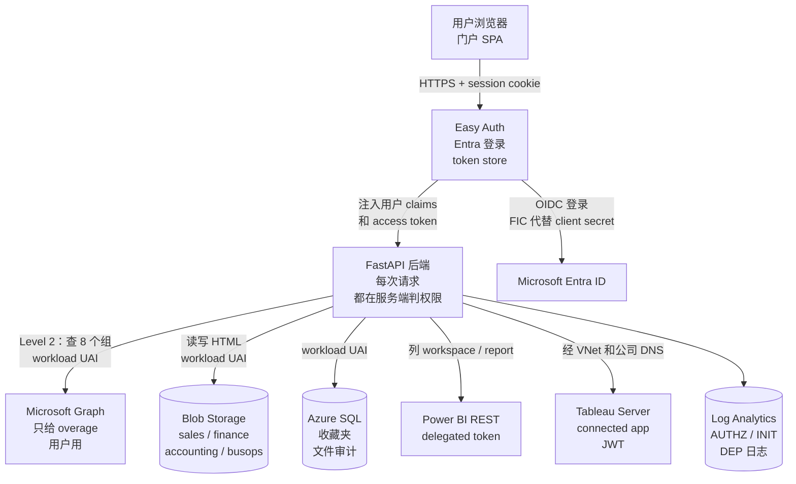
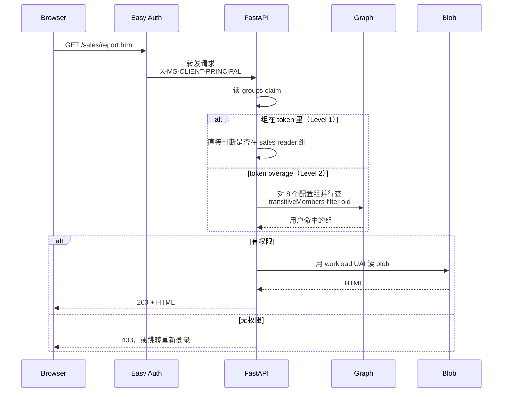

# Unified BI Portal：Fabric / Tableau / AI 生成 HTML 报告的统一入口

> **简历原句：** Shipped a unified BI portal with Fabric, Tableau, and AI-generated HTML reports for 100+ analysts, governed by Entra ID
>
> **一句话：** 分析师用 AI 生成的 HTML dashboard 按业务 domain 存进 Blob，用户用 Entra SSO 登录后，按 AD 组只能看到自己 domain 的报告；同一个页面再列出他在 Power BI / Fabric 和 Tableau 里有权限的内容。Azure 侧的身份全部免密（唯一的 secret 是 Tableau connected app 的签名密钥）。
>
> *EN:* One Entra-protected portal where analysts publish AI-generated HTML dashboards per business domain, and each user sees only what their AD groups allow — next to their Power BI, Fabric and Tableau content. Every Azure identity in it is secretless.

---

## 1. 面试怎么讲

### 30 秒版本

> *EN:* Analysts started generating HTML dashboards with AI, but there was no governed place to share them, and reports were scattered across Power BI and Tableau. I built a portal on Azure App Service: Easy Auth handles Entra sign-in with a federated credential instead of a secret, each business domain has its own blob container with a reader and a contributor group, and the backend authorizes every request server-side. The hard parts were users with too many groups for the token, Conditional Access blocking delegated Power BI tokens, and getting Tableau reachable from inside the corporate network.

中文对照：分析师开始用 AI 生成 HTML dashboard，但没有受治理的地方分享，报告还散在 Power BI 和 Tableau。我在 App Service 上做了这个 portal：Easy Auth 负责 Entra 登录，用联合凭据替代 secret；每个业务 domain 一个 blob container、一个 reader 组和一个 contributor 组；后端每次请求都在服务端判权限。难点是组太多塞不进 token 的用户、CA 策略挡掉 delegated Power BI token、以及从公司内网访问 Tableau。

### 2 分钟版本

讲的顺序：为什么要做 → 怎么设计 → 身份上的两个难点 → 先观测再优化。英文约 300 词，正常语速两分钟左右。每段先看英文怎么说，下面是同一段的中文。

**① 为什么要做**

> *EN:* So the background is, our analysts started using AI to build HTML dashboards. It's really fast — you describe what you want and you get a single HTML file. But then, where do you put it? People were emailing files around or dropping them on shared drives, with zero access control. And their other reports were already split between Power BI and Tableau. So I built one portal for all of it.

背景是这样的：分析师开始用 AI 做 HTML dashboard，特别快，说一下要什么，就出来一个 HTML 文件。问题是做完放哪？大家要么发邮件，要么扔共享盘，完全没有权限控制。而且他们别的报表本来就分散在 Power BI 和 Tableau 两边。所以我做了一个统一的入口，把这些都放到一起。

**② 怎么设计**

> *EN:* The design itself is pretty simple. It's a FastAPI app on App Service. Easy Auth does the Entra sign-in, and it uses a federated credential instead of a client secret, so there's nothing to rotate. Each business domain gets its own blob container with a reader group and a contributor group, and every request is checked on the server side — never in the browser. The same page also shows what you can open in Power BI and Tableau.

设计本身不复杂，就是一个跑在 App Service 上的 FastAPI。Easy Auth 负责 Entra 登录，用的是联合凭据，不是 client secret，所以没有密钥要轮换。每个业务 domain 一个 blob container，配一个 reader 组和一个 contributor 组，每次请求都在服务端判权限，绝不放在浏览器里判。同一个页面上还能看到你在 Power BI 和 Tableau 里能打开的东西。

**③ 难点在身份**

> *EN:* The hard part was identity. First, some people are in hundreds of AD groups, so the groups don't even fit in the token. For them I call Graph, but I flip the question: instead of "which groups is this user in", I ask each of our eight groups "is this person a member" — that needs a much narrower permission. Second, Power BI needs the user's own token, and Conditional Access blocks the background refresh after about ninety minutes, because the server isn't a compliant device. So when that happens, we just send the user through a quick sign-in on their own laptop.

真正难的是身份。第一，有些人在几百个 AD 组里，token 根本装不下。这类用户我去调 Graph，但不问"这个人在哪些组"，而是反过来问我们那 8 个组"这个人在不在你里面"，这样需要的权限窄得多。第二，Power BI 必须用用户自己的 token，可大概 90 分钟后，后台刷新会被 Conditional Access 挡掉，因为服务器不是合规设备。所以碰到这种情况，就让用户在自己电脑上快速重新登录一下。

**④ 先观测再优化**

> *EN:* One last thing. After the move to FastAPI, people said it felt slower. Instead of guessing, I checked — prod had zero telemetry for a whole week. So I added structured logs first, and the numbers said it was config, not Python: four gunicorn workers on a single core, and a cold SQL connection on the landing page. It's now used by over a hundred analysts. My takeaway: make it observable before you make it fast.

最后说一点。迁到 FastAPI 以后，大家觉得变慢了。我没去猜，先查了一下：prod 整整一周一条遥测都没有。所以先补上结构化日志，数据一出来就清楚了，是配置问题，不是 Python 的问题——单核机器上跑了 4 个 gunicorn worker，首页还在等一个冷的 SQL 连接。现在有一百多个分析师在用。我的收获是：想让它变快之前，先让它看得见。

### 数字和口径（被追问时别讲错）

| 说法 | 依据 | 备注 |
|---|---|---|
| 4 个业务 container：sales / finance / accounting / busops | `container-config.json` | 每个 container 一个 reader 组 + 一个 contributor 组 |
| Level 2 阈值约 200 个组 | 实测：177 组仍是 Level 1，211 / 212 / 218 是 Level 2 | 是"每个用户"的属性，同一个组里有人 L1 有人 L2 |
| Level 2 授权：冷启动 18s，热态约 0.6s；Level 1 是 0–1ms | 遥测实测 | 冷是依赖连接冷（token / TLS），不是进程冷启动 |
| Power BI 列表请求数 = 1 + 3W（W = workspace 数） | `powerbi.py` | 前端并发池 4，localStorage 缓存 30 分钟 |
| delegated token 大约 90 分钟后被 CA 挡 | `AADSTS50097` | 服务端 headless refresh 没有设备身份 |
| 100+ analysts | ⚠️ 本地只有 sbx 七天 1,674 次点击，没有用户数统计 | 面试前想好口径（注册的 contributor + reader？） |

---

## 2. Deep dive：5 个问题

### Q1. How does authorization work, especially for users who belong to hundreds of groups?（授权怎么做？组特别多的用户怎么办？）

**中文要点**
- Level 1：app registration 设 `groupMembershipClaims: SecurityGroup`，组进 id_token，Easy Auth 每次请求注入 `X-MS-CLIENT-PRINCIPAL`，后端直接读，零 Graph 调用。
- Level 2（overage）：token 装不下时只给一个 overage 标记，必须调 Graph。前后试了 4 个 endpoint：
  - `/me/memberOf`（delegated）：用户 token 约 90 分钟后被 CA 挡，Level 2 用户直接断掉。
  - `/users/{oid}/memberOf`（app-only）：要 `Directory.Read.All`，太宽，每次 403。
  - `/users/{oid}/checkMemberGroups`：要 `User.ReadBasic.All`，刚授权的 role 卡在 MI token 缓存里，有的实例有有的没有，403 时好时坏。
  - `/groups/{gid}/transitiveMembers`（每组一次、并行）：只要 `GroupMember.Read.All`，立刻生效，还能处理嵌套组。
- 规律：从"用户那头"问要读用户的权限；从"组那头"问只要读组成员的权限。
- 最大的坑：给 MI 新授 app role 不会马上进 token，App Service 还会缓存 MI token，`restart` 不可靠，Consumption 多实例各缓存各的。诊断方法是解码 MI token 打出 `roles` claim（只打 roles，不打 token）。教训：关键路径别依赖刚授的权限。
- 授权判断永远在服务端。localStorage 里的组只决定 UI 显示哪些卡片，不决定能不能下载文件。

**EN answer**
> Most users have their groups right in the ID token, so authorization costs nothing. For users above roughly two hundred groups the token overflows, so the backend calls Graph with an app-only token. I went through four endpoints. The final one asks each of our eight configured groups whether the user is a transitive member, in parallel. It only needs GroupMember.Read.All, which was already reliably in the token. The real lesson was that a newly granted app role can take hours to show up in a cached managed identity token — decoding the roles claim told me it was propagation, not my code.

### Q2. Why is it secretless, and what identities are involved?（为什么能做到免密？有几个身份？）

**中文要点**
- 三段信任关系：用户 ↔ Easy Auth（OIDC 授权码流）；Easy Auth ↔ Entra（用 UAMI 的 token 当 client assertion，FIC 的 audience 是 `api://AzureADTokenExchange`）；后端 ↔ Graph / Blob / SQL（workload UAI）。
- 为什么 workload 不用 system MI：system MI 生命周期绑在 app 上，app 删掉重建后 principalId 变了，Graph app role 要找云团队带外重新授权（真实踩过：重建 sbx 后 system MI 和站点绑定都丢了）。
- 为什么不用 app registration 去调 Graph：app-only 调用就得配 secret 或证书，等于把刚去掉的密钥请回来，还让登录身份多握一份读全租户组成员的权限。
- 两个 UAI 都挂在 Web App 上时，MSI endpoint 分不清用哪个，代码里必须显式传 `client_id`。
- Storage 和 SQL 不需要 admin consent：Storage 是 RBAC 角色分配，SQL 是 contained user + GRANT；只有 Graph 的 `GroupMember.Read.All` 要走申请和 admin consent。

**EN answer**
> There are three trust relationships and none of them uses a stored secret. Easy Auth signs users in and proves the app's identity to Entra with a federated credential backed by a dedicated managed identity. A separate user-assigned identity handles Graph, Blob and SQL. I moved off the system-assigned identity because its principal ID changes whenever the app is recreated, which means re-granting Graph permissions out of band every time.

### Q3. How did you integrate Power BI given Conditional Access?（Conditional Access 下 Power BI 怎么接？）

**中文要点**
- 要展示"这个用户能看到哪些 report"，语义上必须用 delegated token；UAI 是 app-only，看到的是 SP 自己的权限，和登录用户无关。
- 当前实现：Easy Auth `loginParameters` 带上 Power BI scope，后端读注入的 `x-ms-token-aad-access-token` 调 Power BI REST。踩过的坑：app registration 声明了 `Dashboard.Read.All`，但 `loginParameters` 没申请，token 里就没有。
- CA 问题：大约 90 分钟后 Easy Auth 在服务端 headless 用 refresh token 续期，服务器没有设备身份，被设备合规策略挡（`AADSTS50097`）。这不是权限缺失，是"刷新发生的位置"不对。
- 选定的应对：redirect re-auth。token 失效时前端整页跳转到 `/.auth/login/aad`，交互式登录发生在用户的合规设备上，通常无感一闪；代价是每个周期都会发生一次。注意 SPA 的后台 fetch 不能跟随 302 去交互登录，必须整页跳转。
- 规模化方向：改成 application 权限 + Power BI Scanner（Admin）API，后台定时把 workspace → item → access 同步进 Azure SQL，登录时只查库。关键区别：delegated 的限流按"用户 × 应用"分桶，application 全部挤在一个 SP 的桶里，所以 app 权限只能配后台低频批扫，不能配用户实时调用。
- 团队决策背景：solution architect 偏好 Python，对"CA 会挡 delegated token"持保留，所以先走服务端实现，用实测结果驱动决策。

**EN answer**
> Listing a user's own reports needs a delegated token, so I used the one Easy Auth stores. The problem was Conditional Access: after about ninety minutes, Easy Auth refreshes the token server-side, the server isn't a compliant device, and Entra blocks it. The short-term fix is a full-page redirect to interactive sign-in, which happens on the user's compliant device. The long-term direction is a background scan with the Power BI Admin Scanner API into SQL. One subtle point: delegated calls are throttled per user, but application calls all share one service principal's bucket, so app permissions only make sense for low-frequency batch scans.

### Q4. Tell me about a production incident on this project.（讲一个生产事故）

**中文要点**
- Tableau 集成代码本身几乎没错，坑全在环境层，一共六层：
  1. 主机名拼错：别人给的脚本写 `bqai`，实际是 `biqa.carmax.org`，所有环境都 NXDOMAIN。
  2. `biqa` 是 split-horizon DNS 的内部名，公网 DNS 解析不了，必须 VNet integration 才能用公司 DNS。
  3. 新 subnet 没挂路由表，公司 DNS 在防火墙后面到不了，app 的每次 DNS 解析都超时（包括 `api.powerbi.com`），**整站宕了两次**。修法：复用 SHIR subnet 的路由表（`10.0.0.0/8` 和 `172.16.0.0/12` 指向防火墙 NVA，`0.0.0.0/0` 走 Internet）。
  4. `az webapp vnet-integration add` 默认开 route-all。
  5. 内部自签证书导致 TLS 校验失败。
  6. Tableau username 是员工号，不是 email。
- 教训：先单独验证主机名；网络改动是全站级风险，要先在非生产验证、准备回滚；每一层的错误会把下一层藏起来。

**EN answer**
> The Tableau integration code was basically right, but there were six independent environment issues stacked on top of each other — starting with a misspelled hostname we copied from someone's script. The painful one was VNet integration: the new subnet had no route table, so the app couldn't reach corporate DNS, every DNS lookup timed out, and the whole site went down twice. Attaching the same route table the self-hosted IR subnet already used fixed it. My takeaway was to validate each layer independently and treat network changes as site-wide risk.

### Q5. After moving to FastAPI people said it felt slower than the Node version. What did you do?（FastAPI 版本变慢，你怎么处理？）

**中文要点**
- 先承认没法量化：prod App Insights 七天零条。原因是 Python App Service 没有 codeless agent（只有 .NET / Java / Node 有），只设 connection string 等于没接；`azure-monitor-opentelemetry` 又因为 Oryx 打包问题没装。
- 补上结构化日志：`AUTHZ`（level、latencyMs、overage）、`INIT`（blobListMs、favMs）、`ACCESS`、`DEP`（依赖连接耗时）。踩过的坑：一开始查错了日志表，得出"没流量"的假结论。
- 根因分层：
  - B1 单核跑 `gunicorn -w 4`：uvicorn async worker 一个事件循环就够，4 个进程只会把内存和缓存（dashboard 缓存、MSI token、blob 连接池）拆成 4 份，低流量下常打到冷 worker。建议 `-w 1~2`。
  - 首次登录卡十几秒：`/api/init` 串行等 favorites 的冷 SQL 连接（超时 15 秒），前端又把整个渲染卡在 `/api/init` 上。
  - 每次读 blob 多一次 `exists()` 往返；overage 用户每次点击重打 8 次 Graph，没有结果缓存。
- 框架没选错：这是 I/O 型薄代理，Node 和 FastAPI 都够用。

**EN answer**
> The first thing I found was that production had zero telemetry for a week — Python on App Service has no auto-instrumentation, so the connection string alone did nothing. I added structured logs for authorization, page init and dependency calls, then measured. The issues were configuration: four gunicorn workers on a single-core B1 plan split every cache four ways, and the landing page waited serially on a cold SQL connection. It wasn't a Python problem.

---

## 3. 参考文档

| 想复习什么 | 文档 |
|---|---|
| 四个身份对象的职责和 FIC | [identity-architecture-zh](</Users/wqeq/Desktop/project/html-upload-kmx/docs/identity-architecture-zh.md>) |
| Level 2 试过的 4 个 endpoint、MI token 缓存坑 | [level2-group-resolution-final-zh](</Users/wqeq/Desktop/project/html-upload-kmx/docs/level2-group-resolution-final-zh.md>) |
| Function App → Web App → FastAPI → Power BI 三阶段迁移 | [webapp-fastapi-migration-plan-zh](</Users/wqeq/Desktop/project/html-upload-kmx/docs/webapp-fastapi-migration-plan-zh.md>) |
| CA block 和 redirect re-auth | [powerbi-ca-redirect-reauth-zh](</Users/wqeq/Desktop/project/html-upload-kmx/docs/powerbi-ca-redirect-reauth-zh.md>) |
| Power BI 两条扩展路径、限流分桶 | [powerbi-scaling-two-paths-zh](</Users/wqeq/Desktop/project/html-upload-kmx/docs/powerbi-scaling-two-paths-zh.md>) |
| Tableau 六层坑、两次宕机 | [tableau-deploy-postmortem-zh](</Users/wqeq/Desktop/project/html-upload-kmx/docs/tableau-deploy-postmortem-zh.md>) |
| 性能诊断、gunicorn worker | [webapp-fastapi-perf-diagnosis-zh](</Users/wqeq/Desktop/project/html-upload-kmx/docs/webapp-fastapi-perf-diagnosis-zh.md>) |
| 冷热分层遥测数字 | [telemetry-cold-warm-l1-l2-zh](</Users/wqeq/Desktop/project/html-upload-kmx/docs/telemetry-cold-warm-l1-l2-zh.md>) |
| 项目踩坑和分歧（17 个 pitfall、11 个分歧） | [项目 context 索引](</Users/wqeq/Desktop/project/html-upload-kmx/doc/context-index.md>) |
| 代码入口 | `src/main.py`（路由与授权）、`auth.py`、`graph.py`、`powerbi.py`、`tableau.py`、`obs.py` |

---

## 4. 这个项目是干什么的

**它是一个跑在 Azure App Service（Python FastAPI）上的门户。** 用户打开首页，Easy Auth 先完成 Entra 登录；首页调 `/api/init`，后端按用户的组算出他能看到哪些 domain container，同时列出他的 Power BI / Fabric 和 Tableau 内容。点开一个 HTML 报告时，后端再判一次权限，然后用 workload UAI 从 Blob 读出文件返回。contributor 组的人可以上传、重命名、删除、认证（certify）报告，每次文件操作写一条审计事件；收藏夹存在 Azure SQL。

项目最早是 Node 的 Function App，后来分三阶段迁到 Web App + FastAPI：先改 infra（新建 workload UAI），再逐路由移植代码，最后加 Power BI。

### 整体架构

### 打开一个 HTML 报告时的授权流程

### 身份一览

| 身份 | 用来做什么 | 为什么这样设计 |
|---|---|---|
| App Registration | Easy Auth 的登录 client，发 id_token（带 groups），声明 Power BI delegated 权限 | 只有它能发用户 token |
| easyAuth UAI | 只做 FIC，替代 client secret | 微软要求 FIC 身份不能挂别的权限 |
| workload UAI | Graph（`GroupMember.Read.All`）、Blob、SQL | 生命周期独立于 app，删了重建不用重新授权 |
| Tableau connected app | 后端用 connected app secret（存在 app setting）签 4 分钟 HS256 JWT，代表用户登录 | 这是全项目唯一的 secret；它是服务端凭据，所以不受 CA 设备策略影响 |
