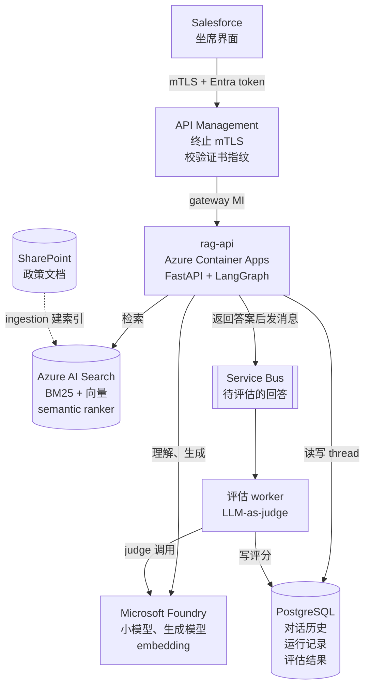
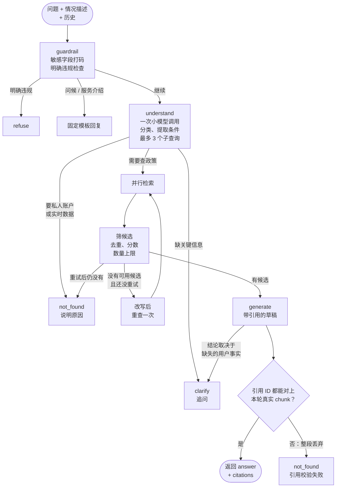

# Enterprise RAG Advisor：坐席接电话时实时查州政策

> **简历原句：** Enabled 1,000+ call center associates through a Salesforce-integrated Enterprise RAG Advisor to access state-specific policies from SharePoint during live calls, delivering 5-second P95 response latency using Microsoft Foundry, ACA, and Azure AI Search, with APIM-enforced mTLS and asynchronous answer evaluation via Service Bus.
>
> **一句话：** 坐席在 Salesforce 里接电话时直接提问，系统从 SharePoint 来的政策文档里检索，分清是哪个州、哪种情况，给出带引用的答案；信息不够就追问，知识库没有就明说，P95 控制在 5 秒内。
>
> *EN:* While on a live call, an associate asks a policy question inside Salesforce, and the advisor answers from SharePoint policy documents with citations, keeps state-specific rules apart, asks a clarifying question when facts are missing, and says "not found" instead of guessing — all within a five-second P95.

> ⚠️ **先分清两样东西。** 简历写的是 CarMax 的生产项目（本地文档里叫 EKA，两个索引合计约 1,650 篇文档、约 7,900 个 chunk）。本地 `rag` 文件夹是我**用公开政策数据集重建的版本**（ConditionalQA + MultiDoc2Dial，1,140 篇、3,945 个 chunk），目的就是面试时能完整展示代码、数据和评估，不碰公司数据。面试里可以主动说这一点，它是加分项。
>
> *EN:* "The production system uses internal policies, so I rebuilt the same architecture on public policy datasets of similar scale. That lets me show real code and evaluation numbers without touching company data."

---

## 1. 面试怎么讲

### 30 秒版本

> *EN:* Call center associates had to search SharePoint for state-specific policies while a customer was on the line. We built a RAG advisor embedded in Salesforce. External calls come through APIM with mutual TLS, the service runs on Azure Container Apps, retrieval is Azure AI Search, and the models are on Microsoft Foundry. The service answers with citations, routes to clarify or not-found when the evidence doesn't support an answer, and we evaluate answer quality asynchronously through Service Bus, so evaluation never adds latency to the live call. P95 is about five seconds.

中文对照：坐席要在客户等着的时候去 SharePoint 翻各州政策。我们做了一个嵌在 Salesforce 里的 RAG advisor：外部调用经 APIM 走 mTLS，服务跑在 ACA，检索用 Azure AI Search，模型在 Foundry。答案带引用，证据不够就追问或说没找到；答案质量评估通过 Service Bus 异步做，不拖慢通话。P95 约 5 秒。

### 2 分钟版本

讲的顺序：业务约束 → 一次请求怎么走 → 怎么保证可信 → 延迟和评估 → 为什么选 ACA 和结果。英文约 300 词，正常语速两分钟左右。每段先看英文怎么说，下面是同一段的中文。

**① 业务约束**

> *EN:* So this was for our call center. Associates are on a live call, the customer is waiting, and they need a policy answer — and the answer often depends on the state. Before this, they had to dig through SharePoint while the customer was on hold. So three things drove the whole design: it has to be fast, it has to be right — because a wrong policy answer is a compliance problem — and it can't mix up one state's rules with another's.

这是给呼叫中心做的。坐席在打电话，客户在等，他们需要一个政策答案，而且答案经常跟州有关。以前只能让客户等着，自己去 SharePoint 里翻。所以整个设计就被三件事决定：要快；要对，因为答错政策是合规问题；还有不能把不同州的规定混在一起。

**② 一次请求怎么走**

> *EN:* It's embedded in Salesforce. Calls come in through APIM with mutual TLS, into Container Apps running FastAPI and LangGraph. One small model call works out what's being asked and rewrites it into up to three searches, which run in parallel on AI Search. Then the bigger model writes the answer from that evidence.

它嵌在 Salesforce 里面。请求先过 APIM，走双向 TLS，进到 Container Apps，里面跑的是 FastAPI 加 LangGraph。先用一次小模型调用搞清楚问的是什么，顺便改写成最多三个检索，这几个检索在 AI Search 上并行跑，然后大模型根据检索到的证据写答案。

**③ 怎么保证可信**

> *EN:* The part I care most about is trust. Every claim has to point to a chunk we actually retrieved — if a citation doesn't check out, we throw away the whole draft and say "not found". If a key fact is missing, it asks a clarifying question instead of guessing. And I deliberately don't hard-filter on a state the model guessed from the question, because if that guess is wrong, the right document is just gone.

我最在意的是可信。每一句结论都必须指向这一轮真的检索到的 chunk，引用对不上，整段草稿直接丢掉，回答"没找到"。缺关键信息就追问，不去猜。另外我故意不拿模型从问题里猜出来的州去做硬过滤，因为一旦猜错，正确的文档就直接没了。

**④ 延迟和评估**

> *EN:* For latency, I started from a budget — about two and a half seconds on the normal path — and allowed at most one retry, so P95 lands around five seconds. Evaluation runs on LangSmith and never sits on that path: before every release, we run the golden set as an experiment, and after go-live, live answers are traced and scored for groundedness after the fact.

延迟方面，我先排了个预算，正常路径大概两秒半，重试最多一次，所以 P95 落在 5 秒左右。评估放在 LangSmith 上，而且绝不卡在这条路上：每次发布前，把 golden set 当成一次 experiment 跑一遍；上线以后，线上的回答都有 trace，事后再给它们打 groundedness 分。

**⑤ 为什么选 ACA，以及结果**

> *EN:* Why Container Apps and not AKS? It's one low-traffic service — not worth running Istio and a firewall for. Today over a thousand associates use it. And I rebuilt the same design on public policy datasets, so I'm happy to show you real code.

为什么用 Container Apps 不用 AKS？就一个低流量的服务，不值得为它养一套 Istio 和防火墙。现在有一千多个坐席在用。另外我用公开的政策数据集把同样的设计重建了一遍，有兴趣的话可以给你看真实的代码。

> ⚠️ 这段按 1108 版简历讲：评估写的是 "evaluation via LangSmith"（1102 版是 "asynchronous answer evaluation via Service Bus"）。本文的 30 秒版本、Q4、架构图和口径表还是 Service Bus 的讲法，统一之前别在同一场面试里混着讲。

### 数字和口径（被追问时别讲错）

| 说法 | 依据 | 备注 |
|---|---|---|
| P95 ≤ 5s；无重试路径预算约 2.5s | 本地设计文档的延迟预算表 | ⚠️ 本地重建版没有压测结果；5 秒是生产口径，准备好说是怎么测的 |
| 生产规模约 1,650 篇、约 7,900 chunk，两个索引 | 本地设计文档对 EKA 的描述 | 重建版：1,140 篇、3,945 chunk，500 token / 50 overlap |
| 1,000+ associates、Salesforce 集成、SharePoint 来源 | ⚠️ 本地没有实现 | 生产事实，面试前回忆 Salesforce 怎么嵌（LWC / Canvas？）和 SharePoint 同步方式 |
| Service Bus 异步评估 | ⚠️ 本地重建版没有 Service Bus，只有"在线采样 judge"的设计 | 下面 Q4 给的是和简历一致的讲法，按真实实现核对 |
| 部署形态 | 简历写 ACA；本地设计文档把 AKS + LangSmith Agent Server 写成"现有方案" | ⚠️ 确认生产到底跑在哪；Q5 按 ACA 回答 |

---

## 2. Deep dive：5 个问题

### Q1. How did you get to a five-second P95 on a live call?（P95 5 秒是怎么做到的？）

**中文要点**
- 先排预算再写代码（无重试路径）：

  | 阶段 | 预算 |
  |---|---:|
  | APIM + 读对话历史 | 80 ms |
  | 规则 guardrail | 10 ms |
  | understand（小模型） | 400 ms |
  | query embedding + 并行检索 | 450 ms |
  | 筛选、组装上下文 | 30 ms |
  | 生成并缓冲完整草稿 | 1,500 ms |
  | 校验、写库、返回 | 50 ms |
  | **合计** | **约 2.5 s** |

- 省时间的几个决定：分类和查询改写合并成一次小模型调用；最多 3 个子查询并行；最多改写重查一次（总共两轮检索）；问候、"你能做什么"这类走固定模板，不调生成模型；评估从关键路径上拿掉，走 Service Bus 异步。
- P95 和 P50 的差距主要来自重试路径和长答案，所以把重试次数卡死，生成长度也有上限。
- 一个容易被追问的点：既然要先校验引用，就不能边生成边把未校验的政策句流给坐席。SSE 可以先推"正在检索"这类进度，但答案文本是校验后才发。

**EN answer**
> I started from a latency budget: about 2.5 seconds on the no-retry path, with generation taking most of it. To protect the tail, routing and query rewriting share one small-model call, sub-queries run in parallel, there's at most one rewrite-and-retry, and greetings use templates without calling the generator. Evaluation is pushed off the critical path to Service Bus. One trade-off: because citations are validated before anything is shown, we buffer the draft instead of streaming unverified policy text.

### Q2. How do you make sure the answer is grounded — and that it's the right state's policy?（怎么保证答案有依据，而且是对的州？）

**中文要点**
- 生成模型输出的是"带引用的 claims"。给模型的证据用短 ID（E1、E2…），代码严格映射回本轮真实的 chunk ID；出现未知 ID 就拒绝发布。引用校验失败不是删掉引用了事，而是整段草稿丢弃，返回 `not_found / citation_validation_failed`，因为删引用会留下没依据的政策陈述。
- 两个澄清入口：检索前发现问题本身缺信息（"哪个福利？"）；读完政策才发现结论取决于某个用户事实（比如居住时长）。用户只问一般规则时，直接给条件式说明，不一律追问。
- 州的处理（重点）：
  - 检索层面，一个合并索引，正文和标题走 BM25，向量走相似度，metadata 负责来源、定位和引用。
  - **不把模型从问题里猜出来的州当成硬 filter。** 硬 filter 一旦排除了正确 chunk，后面的 rerank 救不回来，recall 直接损失。比如"住在 A 州、问 B 州的规定"就不能按一个地名过滤。
  - 硬约束只用于可信来源的范围：权限隔离，或者调用方明确给出的范围。⚠️ 生产版如果是从 Salesforce case 的结构化字段拿到客户所在州，那个可以当 filter 或 boost，因为它不是模型猜的——这一点按真实实现核对。
- 分数只用来筛候选，不能证明条件、例外都齐了；能不能回答由 generate 根据证据判断，不额外加一轮 judge。

**EN answer**
> The generator returns claims tied to short evidence IDs, and the code maps them back to the real chunk IDs. Any unknown ID means the draft is discarded and we return not-found, because dropping a citation would leave an unsupported policy statement. For jurisdiction, I don't turn a state the model inferred from the question into a hard filter — if that filter is wrong, the right chunk is gone and no reranker can bring it back. Hard filters are for trusted scope, like a structured field from the calling system or permission trimming.

### Q3. Walk me through the security model.（讲一下安全设计）

**中文要点**
- 外部系统调用 mTLS 是设计的硬要求。我一开始想把它当可选项（内部都用 MI 了），被纠正：外部接入要求和服务间认证是两回事。
- APIM 终止 mTLS：全局 policy 用 `validate-client-certificate` 校验精确指纹、not-before / not-after；未提供证书 403，未登记证书 401。轮换时短暂保留新旧两个指纹。小坑：APIM Consumption 用 `enableClientCertificate`，`negotiateClientCertificate` 是其他 tier 的配置，用错直接创建失败。
- 往里全部用 Managed Identity：APIM 用 gateway MI 调 ACA；ACA Easy Auth 只放行 gateway MI 和内部 eval MI；应用自己再验 Entra token 的签名、issuer、audience、过期和 `azp / appid` 白名单。
- 调用方身份透传：只有确认 token 来自网关时，才信任 APIM 写入的 `X-Rag-Caller-Object-Id`，用来做 thread 归属检查；内部直连的身份用自己 token 的 `oid`。
- 没有 API key、没有数据库密码：PostgreSQL 是 Entra-only，每个新连接现取 token，TLS `verify-full`；Search 和 Foundry 都关掉 key 认证。

**EN answer**
> External callers must present a registered client certificate — APIM terminates mutual TLS and validates the exact fingerprint and validity window. Behind the gateway everything uses managed identity: APIM calls the container app with its own identity, Easy Auth only admits the gateway and the evaluation identity, and the app validates the token and an allow-list of client IDs again. There are no API keys or database passwords anywhere — Postgres, Search and Foundry are all Entra-only.

### Q4. How do you evaluate answer quality, and why asynchronous through Service Bus?（怎么评估质量？为什么用 Service Bus 异步？）

**中文要点**
- 三层：离线评估决定能不能发布；在线评估发现离线没覆盖的问题；数据飞轮把线上问题变成新的评估样本或内容修复。
- 离线：golden set 按地区、机构、条件题、多轮分层；指标同时报 doc recall、chunk 命中和 evidence span coverage（命中一个相交的 chunk 不代表答案条件都覆盖了）、条件正确性、route 是否正确。dev 调参，test 只测一次，不把 gold 泄露给服务。
- LLM-as-judge 要先校准：拿人工标注的子集对比 judge 的打分，一致性够了才用。
- 在线 + 异步（和简历一致的讲法，⚠️ 按真实实现核对细节）：答案返回给坐席后，服务把 `run_id`、问题、检索到的证据、答案作为一条消息发到 Service Bus；评估 worker 消费消息，跑 groundedness 和相关性 judge，结果写回数据库。为什么异步：judge 本身是一次 LLM 调用，放在关键路径上会直接吃掉延迟预算；队列还能削峰、失败重试、死信，judge 挂了不影响业务。
- 隐式信号也要看：not_found 率（按原因拆分：能力限制、引用失败、真的没内容）、同一 thread 60 秒内重问、👎 反馈。
- 一个错误答案的诊断顺序：应引用的文档在候选里吗 → 在索引里吗 → 进了最终上下文吗 → 回答忠于证据吗。分别对应内容缺失、检索问题、截断排序问题、生成幻觉。

**EN answer**
> Offline evaluation on a stratified golden set gates every release — we report retrieval recall, evidence-span coverage, condition correctness and whether the route was right. Online, after the answer is returned, the service publishes the question, evidence and answer to Service Bus, and a worker runs groundedness and relevance judges. It's asynchronous because a judge is another LLM call — on the critical path it would blow the latency budget. The queue also gives us retries and a dead-letter path, so a judge outage never affects the associate.

### Q5. Why Azure Container Apps instead of AKS with a LangSmith Agent Server?（为什么用 ACA，不用 AKS + Agent Server？）

**中文要点**
- 运维组件对比：ACA 方案只有 APIM、Container App、Postgres；AKS 方案要 Traffic Manager、AGC、Istio、KEDA、OTel、Prometheus、Azure Firewall、Redis Enterprise，还有 LangSmith 控制面 listener。
- 固定成本：AKS 方案里防火墙、Redis、节点和流量无关，零流量也要付。
- LangGraph 在这里只当一个 Python 库，包在 FastAPI 里，不需要 Agent Server、任务队列或 K8s。请求是同步的，不需要 Redis pub/sub。
- 发布用 ACA 原生的 revision + 流量切分。评估是同一个镜像的 ACA Job。
- 什么时候该迁过去：agent 数量超过 5–10 个、由多个团队维护；出现分钟级长任务需要后台队列和断点续跑；需要统一部署管理和 Studio；公司已经有共享 AKS 平台和运维团队。
- 两者不冲突：Graph 的业务节点可以复用，但 API、身份、持久化和部署要重新适配。

**EN answer**
> For one low-QPS RAG service, AKS with an agent server means running Istio, an app gateway, KEDA, a firewall and Redis — mostly fixed cost and operational load that doesn't scale with traffic. LangGraph works fine as a library inside FastAPI on a container app, with revisions for traffic splitting and an ACA job for evaluation. I'd move to the agent platform when we have many agents owned by different teams, long-running background tasks, or an existing shared AKS team.

---

## 3. 参考文档

| 想复习什么 | 文档 |
|---|---|
| 总设计：需求、架构、LangGraph、延迟预算、评估、AKS 对比、面试讲法 | [rag-service-system-design-aca-langgraph](</Users/wqeq/Desktop/project/rag/rag-service-system-design-aca-langgraph.md>) |
| 同一份设计的图片版 | [rag-service-system-design-aca-langgraph-images](</Users/wqeq/Desktop/project/rag/doc/rag-service-system-design-aca-langgraph-images.md>) |
| 索引 schema、为什么不按模型猜的地区硬过滤 | [search-index-design](</Users/wqeq/Desktop/project/rag/doc/search-index-design.md>) |
| APIM mTLS、MI、资源清单和费用 | [infra](</Users/wqeq/Desktop/project/rag/doc/infra.md>) |
| 三个部署版本的差异 | [rag-infra-versions](</Users/wqeq/Desktop/project/rag/doc/rag-infra-versions.md>) |
| 已实现的 chat API：引用映射、thread 归属、幂等 | [rag-chatapp README](</Users/wqeq/Desktop/project/rag/rag-chatapp/doc/README.md>) |
| 实际部署和验收记录 | [chat-rag-flow/azure-deployment](</Users/wqeq/Desktop/project/rag/doc/chat-rag-flow/azure-deployment.md>) |
| 数据集选择和转换 | [data-preparation](</Users/wqeq/Desktop/project/rag/doc/data-preparation.md>) |
| 项目踩坑和分歧（mTLS 是硬需求、硬 filter 之争） | [项目 context 索引](</Users/wqeq/Desktop/project/rag/doc/context-index.md>) |

---

## 4. 这个项目是干什么的

**它是一个 headless 的 RAG API。** 调用方（生产里是 Salesforce，重建版里是 demo UI 和评估 runner）发 `POST /v1/chat`，带上问题、可选的情况描述和 `thread_id`；服务读取这个 thread 的历史，判断该回答、追问、说没找到还是拒绝，需要检索时去 Azure AI Search 找证据，用 Foundry 上的模型生成带引用的答案，校验通过后返回，并把这一轮写进 PostgreSQL。

### 整体架构（按简历口径）

### 一个问题在服务里怎么走

### 状态和持久化

| 存什么 | 在哪 | 说明 |
|---|---|---|
| 对话历史、已确认的条件 | PostgreSQL | 追问时不用再传情况描述也能恢复；历史 AI 回复不当政策证据 |
| 本轮候选、草稿、重试次数 | 只在本轮内存 | 每轮重置，不跨轮累积 |
| 幂等 | `request_id` | 同一个 ID 同样输入直接返回已存结果；换输入返回 409 |
| 并发保护 | 每个 thread 一个持久化 lease + version | 同一 thread 并发请求返回 409 |
| 向量和正文 | Azure AI Search | 每个 embedding 配置一个合并索引 |
