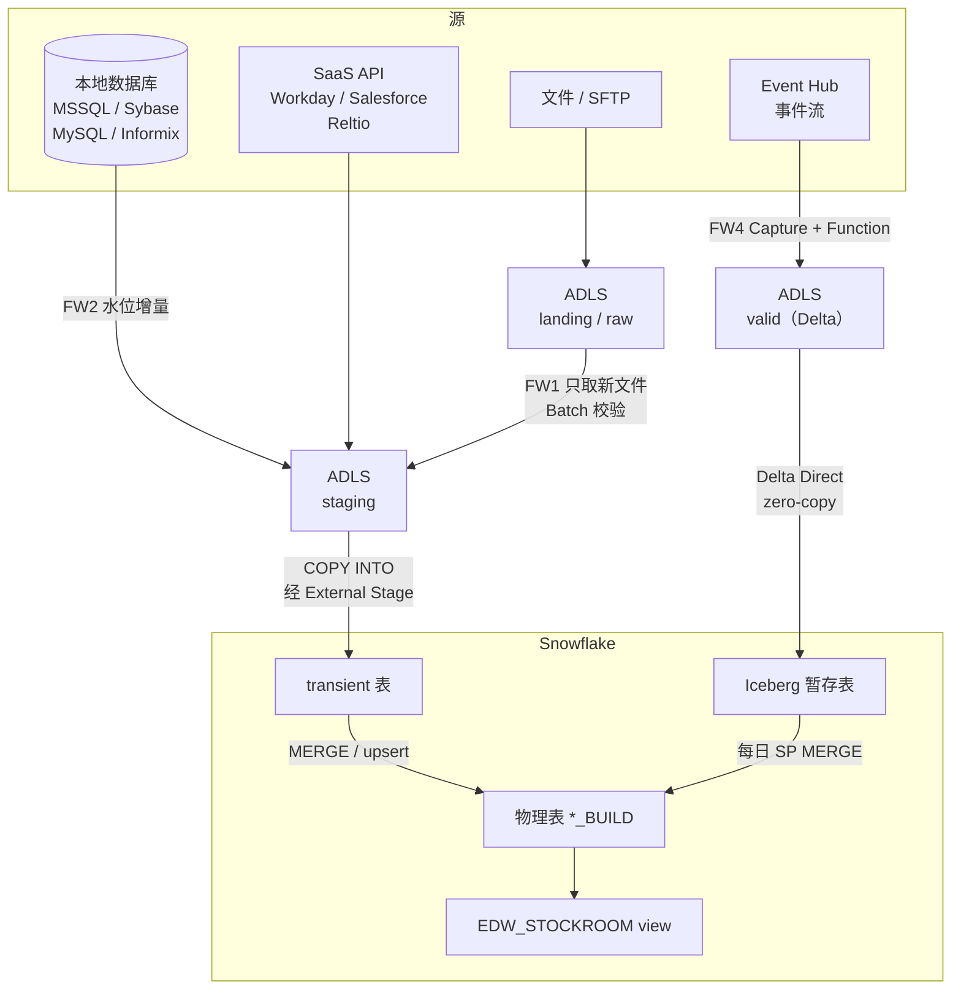
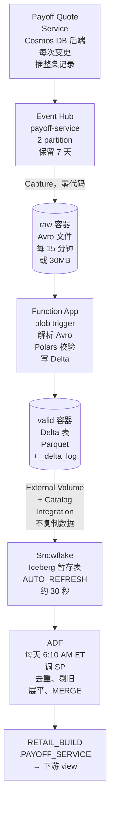

# Enterprise ETL Platform：ADF 平台 Tech Lead、DR、事件驱动 ingestion

> **简历原句（三条）：**
> - Tech lead on the Azure Data Factory platform for 3,200+ pipelines moving 200+ GB/day from multi-cloud, SaaS, and on-prem sources into Snowflake, supporting 50+ data engineers
> - Led ETL platform disaster recovery design and implementation: replicated infrastructure in a secondary Azure region, enabled geo-redundant storage, and built CI/CD support for DR deployments and workload redirection
> - Led event-based ingestion with Cosmos DB, Functions, and Event Hubs; implemented zero-copy to Snowflake via Iceberg
>
> **一句话：** CarMax EDW 的 ingestion 平台：7 个 domain ADF、约 3,200 条 pipeline，靠少数几个 metadata-driven 的通用框架把文件、数据库、SaaS 和事件流灌进 Snowflake。我是平台 tech lead，另外主导了 DR 和事件驱动的新链路（Event Hub → Delta → Snowflake Iceberg zero-copy）。
>
> *EN:* I'm the tech lead for the ingestion platform behind CarMax's enterprise data warehouse — about 3,200 ADF pipelines built on a handful of metadata-driven frameworks. I also led its disaster recovery design and the newer event-driven path that lands data as Delta and exposes it to Snowflake as Iceberg with zero copy.

> ⚠️ **DR 这条本地没有任何文档**（只在 prod 资源清单里看到一个 `edwproddrhashdeployments` 存储账户，用途是 DR 部署制品）。下面 Q5 给的是讲法框架和要回忆的清单，具体 region、RPO / RTO、演练结果要你自己填。200+ GB/day 和 50+ engineers 本地也没有统计。

---

## 1. 面试怎么讲

### 30 秒版本

> *EN:* The platform moves data from on-prem databases, SFTP, SaaS APIs and event streams into Snowflake. Instead of three thousand hand-built pipelines, almost everything runs through five reusable frameworks driven by a metadata control table — onboarding a new source is mostly adding config rows. As tech lead I own those frameworks, the standards around them, monitoring and on-call quality. I also led two bigger initiatives: disaster recovery into a secondary region with CI/CD support for redirection, and an event-based path where a Function writes Delta tables and Snowflake reads them as Iceberg without copying the data.

中文对照：平台把本地数据库、SFTP、SaaS API 和事件流灌进 Snowflake。三千多条 pipeline 几乎都跑在五个通用框架上，由一张 metadata 控制表驱动，新接一个源主要是加配置行。作为 tech lead，我负责这些框架、规范、监控和值班质量；另外主导了两件大事：异地 DR（含 CI/CD 和流量切换），以及事件驱动链路——Function 写 Delta，Snowflake 以 Iceberg 方式零拷贝读取。

### 2 分钟版本

讲的顺序：规模和真正的风险 → 框架化 → 事件驱动链路 → DR。英文约 300 词，正常语速两分钟左右。每段先看英文怎么说，下面是同一段的中文。

**① 规模和真正的风险**

> *EN:* So I'm the tech lead for the ingestion platform behind our data warehouse. It's about thirty-two hundred Data Factory pipelines, bringing data from on-prem databases, SFTP, SaaS APIs and event streams into Snowflake, and more than fifty engineers build on it. At that size, the real risk isn't one pipeline failing — it's everybody building pipelines their own way.

我是数仓背后那个 ingestion 平台的 tech lead。大概三千二百条 Data Factory pipeline，把本地数据库、SFTP、SaaS API 和事件流的数据灌进 Snowflake，有五十多个工程师在上面开发。到这个规模，真正的风险不是哪条 pipeline 挂了，而是每个人都按自己的方式写 pipeline。

**② 框架化**

> *EN:* So almost everything runs on five shared frameworks driven by one metadata table. Adding a new source is mostly adding config rows, not building a new pipeline. Data Factory only orchestrates — Batch does the validation, and Snowflake does the actual loading. Every rerun is safe: we only pick up new files, and Snowflake won't load the same file twice. And when something fails, a ServiceNow ticket opens automatically.

所以几乎所有东西都跑在 5 个共享框架上，由一张 metadata 表驱动。接一个新源，基本就是加几行配置，不用新写 pipeline。Data Factory 只管编排，Batch 做校验，真正装数据的是 Snowflake。任何重跑都是安全的：只取新文件，Snowflake 也不会把同一个文件装两次。出了问题会自动开 ServiceNow 工单。

**③ 事件驱动链路**

> *EN:* I also led the newer event-based path. The source service sits on Cosmos DB and pushes every change to Event Hubs. A Function writes it out as a Delta table in the lake, and Snowflake reads that table as Iceberg — zero copy, nothing gets duplicated. To be honest, the curated table is still daily, because the last merge runs once a day. That's what the business needed. If we ever need fresher data, I'd change that last step, not the front end.

我还主导了新的事件驱动链路。源系统后面是 Cosmos DB，每次变更都推到 Event Hubs。Function 把它写成湖里的 Delta 表，Snowflake 再把这张表当 Iceberg 来读，零拷贝，数据不复制。说实话，正式表现在还是日更，因为最后那一步 MERGE 一天只跑一次。这是业务目前要的；真需要更新鲜的数据，我会改最后那一步，而不是改前面。

**④ DR**

> *EN:* The other big one was disaster recovery. We stood up the platform in a secondary region from the same code, put the landing storage on geo-redundant replication, and made the deployment pipeline region-aware — so failing over is basically the same release pointed somewhere else. The hardest part is in-flight state, like watermarks and checkpoints, and that's exactly where the idempotent design paid off.

另一件大事是 DR。我们用同一套代码在第二个 region 把平台搭起来，landing 存储开异地冗余，部署流水线也做成按 region 参数化，所以切换基本就是同一次发布换个目标。最难的是在途状态，比如水位和 checkpoint，这时候前面做的幂等设计就真派上用场了。

### 数字和口径（被追问时别讲错）

| 说法 | 依据 | 备注 |
|---|---|---|
| 约 3,235 条 pipeline、592 个 trigger、7 个 ADF | 2026-09-16 对 prod 实测 | 简历写 3,200+，一致 |
| 日调度 463 个（约 80%）；事件驱动不到 2% | trigger 实测 | 平台本质是日批体系，事件驱动是新方向 |
| 没有日志级 CDC | 框架实测 | 用水位增量、checkpoint、源端推变更、tumbling window 四种增量手段 |
| Payoff 约 30,000 条/天；Event Hub 2 partition、保留 7 天 | prod 核实 | Capture 间隔 900s、30MB（内部 wiki 写 5 分钟是错的） |
| 暂存表端到端约 15–20 分钟；正式表 T+1 | 链路分析 | 最后一步 ADF 每天 6:10 AM ET 才 MERGE |
| 200+ GB/day、50+ engineers | ⚠️ 本地没有统计 | 想好口径来源（ADF 监控？团队名单？） |
| DR | ⚠️ 本地没有文档 | 见 Q5 |

---

## 2. Deep dive：5 个问题

### Q1. How do you keep 3,200 pipelines manageable?（三千多条 pipeline 怎么管？）

**中文要点**
- 不让人手写 pipeline。FW1 的通用管道只有一个参数 `Pipeline_Name`，其余全查 `DATAOPS.METADATA_CONTROLS.INGESTION_PARAMETERS`：source type、文件路径、目标表、是否走 `COPY INTO`（`SF_COPY_LOAD`）等。一个框架吃 LANDING / EDL / SFTP / STAGING / DB_REPL / EVENTHUB_AVRO 六种源。
- FW2 数据库复制：从 `SF_GENERIC_REPLICATION_CONTROL` 取 `EXTRACT_QUERY`，把 `:last_watermark` 之类的参数替换成上次的高水位，按引擎类型 Switch 到对应的 Copy。
- FW3 多表 fan-out：一个 master 扇出到很多张表，一表一配置行，共用一个 generic child 和一个动态 SQL Data Flow；内建 schema drift 检测（列数是否匹配、哪些列漂移）和对账。
- 横切能力统一做：失败邮件框架（收件人配在 metadata 表）、行数对账（`RECON_CONTROL_FLAG=1` 不符就 fail）、`INGESTION_LOG / ERROR_LOG / ACTIVITY_LOG`。
- 骨架共享、upsert 逻辑按表定制：有的是 MERGE SP，有的是 Data Flow sink upsert，有的还要处理删除日志。这是故意的——业务键和删除语义每张表不同，硬统一反而出错。

**EN answer**
> Engineers don't hand-build pipelines. One generic pipeline takes a single parameter, the pipeline name, and looks everything else up in a metadata control table — source type, paths, target table and load method. Database replication uses a watermark query template, multi-table sources fan out from one master with built-in schema-drift detection, and alerting and reconciliation are shared frameworks. What stays table-specific is the upsert logic, because business keys and delete semantics really do differ.

### Q2. How do you make sure a rerun doesn't duplicate data?（重跑怎么保证不重复？）

**中文要点**
- 取增量：`GetMetadata` 列 landing 和 archive，`Filter` 出 archive 里没有的新文件，只 copy 这些到 staging。
- 装载幂等：transient 表每轮 truncate & load；Snowflake `COPY INTO` 按表维护 load history（文件路径、ETag、大小，保留 64 天），同一文件不会装第二遍，除非 `FORCE=TRUE`。所以 ADF 重试不会翻倍。
- 关键概念别混：External Stage 只是指向 staging 容器的指针，零数据移动；真正搬字节的是 ADF Copy 和 `COPY INTO`。
- MERGE 的标准骨架（以 Payoff 为例）：取窗口（checkpoint 往前 15 分钟到现在，重叠防迟到）→ 每个 key 只留 `lastUpdatedTimestamp` 最新一行（保证 MERGE 单行匹配）→ 剔除比生产表旧的记录（防旧覆盖新）→ 展平 variant → MERGE → 更新 checkpoint。
- 下游 view 是普通 view，查询时实时重算，MERGE 完自动最新，不用刷新。

**EN answer**
> There are three layers. Discovery compares landing against archive, so only new files move. Loading is idempotent because the transient table is truncated each run and Snowflake's COPY INTO keeps a load history, so the same file never loads twice. And the MERGE procedures take an overlapping window, deduplicate to the latest version per key, and drop records older than what's already in production, so late or replayed events can't overwrite newer data.

### Q3. Walk me through the event-based ingestion and the zero-copy part.（讲一下事件驱动链路和 zero-copy）

**中文要点**
- 链路：Payoff Quote Service（Cosmos DB 后端）→ Event Hub `payoff-service` → Capture 成 Avro（15 分钟 / 30MB，空窗口不落文件）→ Blob trigger Function（Python）：解析 Avro、加 `delta_insert_ts` 和来源 blob id、用 Polars 强制 schema → Arrow → 写 Delta → Snowflake Iceberg 暂存表 → ADF 日调 SP MERGE 进正式表 → view。
- 为什么源端推变更：每次 quote 变更补发整条最新记录，相当于"CDC 在源侧完成"，EDW 不需要碰 Cosmos。
- Zero-copy 的三个 Snowflake 对象：External Volume（指向 ADLS + 认证）→ Catalog Integration（`CATALOG_SOURCE=OBJECT_STORE`、`TABLE_FORMAT=DELTA`，官方叫 Delta Direct）→ Iceberg Table（`BASE_LOCATION` 必须指向有 `_delta_log/` 的目录，`AUTO_REFRESH=TRUE`）。
- 内部机制：Snowflake 读 delta log 算出当前 snapshot，在同一批 Parquet 上生成 Iceberg metadata 并写回存储账户；查询时直接扫 ADLS 上的 Parquet。它是持续同步（默认约 30 秒轮询，每次最多处理 1,000 个 commit），不是一次性映射。
- 认证：Snowflake 自动建一个多租户 app，在 CarMax 租户 consent 后，给它的 SP 授存储 RBAC。要让 Snowflake 写 Iceberg metadata，得开 `ALLOWED_WRITE_OPERATIONS` 并给 Storage Blob Data Contributor，只读 Reader 不够。
- 兜底的维护函数：每天比对 raw 和 valid、补跑漏掉的 blob；每天对近 5 天写过的 Delta 表跑 `OPTIMIZE` 压小文件。

**EN answer**
> The source service pushes the full latest record on every change, so change capture happens at the source. Event Hub Capture lands Avro files, a blob-triggered Function enforces the schema with Polars and writes a Delta table. Snowflake then reads that Delta table as an Iceberg table through an external volume and a Delta catalog integration — it reads the Delta log and generates Iceberg metadata over the same Parquet files, so nothing is copied. Two scheduled functions handle the edge cases: one replays blobs that were missed, one compacts small files.

### Q4. Your ingestion is near real-time, but the business table is T+1. Isn't that a contradiction?（接入近实时、正式表却是 T+1，不矛盾吗？）

**中文要点**
- 诚实承认：前半段 15–20 分钟就能在 Iceberg 暂存表查到，但正式表只在每天 6:10 AM ET MERGE，下游用户拿到的还是 T+1。瓶颈在最后一步日调度，不在 Event Hub 或 Function。
- 为什么还这样做：当前下游（BusOps、Asset Protection）要的就是日报；更重要的是 lakehouse 目标——湖里只留一份 Delta，Snowflake、Databricks、Fabric 都能读同一份，不重复存储。
- 想提速的话改最后一步，不改前半段：更勤的调度、Snowflake Dynamic Table 按 lag 自动刷新、或者 Snowpipe Streaming。
- 对替代方案也要说清楚：只给 Snowflake 用、T+1 就够的话，Event Grid + Snowpipe 直接 `COPY` 进原生表，复杂度大约一半；代价是丢掉湖上的开放副本。直接写 Iceberg 可以少一层格式翻译，但 Delta 跟 Databricks 生态更顺。

**EN answer**
> Fair point — staging is queryable within fifteen to twenty minutes, but the curated table is still daily because the final MERGE runs once a day. That matched what downstream teams needed, and the bigger goal was a single open copy in the lake that multiple engines can read. If we needed fresher data, I'd change the last step — a more frequent schedule or a dynamic table — not the ingestion front end. And if Snowflake were the only consumer, Snowpipe straight into a native table would be simpler.

### Q5. How did you design disaster recovery for the platform?（DR 怎么设计的？）

> ⚠️ 本地没有 DR 文档。下面是讲法框架 + 你要回忆的清单。**只讲你真做过的部分**，没做的就说"这是下一步"。

**讲法框架（先讲目标，再讲每一层怎么做）**
1. **先定目标**：RPO / RTO 是多少？是 active-passive 还是 warm standby？（回忆：____）
2. **基础设施**：同一套 IaC 在第二个 region 部署 ADF、Batch pool、Function App、Event Hub namespace、Key Vault、private endpoint 和私有 DNS。East US 2 的 Azure paired region 是 Central US（⚠️ 确认你们用的是不是它）。
3. **数据层**：landing 存储开 geo-redundant（GRS / RA-GRS），failover 后存储 endpoint 怎么切；Snowflake 自己的 replication / failover 是否在你们范围内。
4. **CI/CD**：pipeline 参数化 region / 环境，DR 部署走同一条发布流水线；`edwproddrhashdeployments` 存储账户放 DR 部署制品（⚠️ 回忆 "hash" 指什么——按内容 hash 判断哪些制品需要重新部署？）。
5. **流量切换（workload redirection）**：trigger 在主 region 停、在 DR region 启；Linked Service 和连接串参数化；Self-hosted IR 和 on-prem 网络路径在 DR region 是否可达。
6. **验证**：做过几次演练？发现过什么问题？

**可以主动讲的取舍**：DR 最难的通常不是复制资源，而是有状态的东西——在途文件、checkpoint / 水位、trigger 状态——切换时怎么保证不重复也不漏。平台本来的幂等设计（Q2）正好让 DR 切换后重跑是安全的。

**EN answer（按真实情况改）**
> I started from the recovery objectives, then made the whole platform reproducible from code in the secondary region — Data Factory, Batch, Functions, Event Hubs and Key Vault — with landing storage on geo-redundant replication. The deployment pipeline is parameterized by region, so a DR deployment is the same release with a different target, and workload redirection means stopping triggers in the primary and starting them in the secondary. The hardest part is in-flight state like watermarks and checkpoints, and the idempotent load design is what makes replaying after a failover safe.

---

## 3. 参考文档

| 想复习什么 | 文档 |
|---|---|
| 五个框架、端到端流程、幂等、监控、有没有 CDC | [EDW-ETL-Frameworks-Overview](</Users/wqeq/Desktop/external_project/dape_project_sync_0916/EDWStudy/EDW.wiki/EDW-ETL-Frameworks-Overview.md>) |
| Payoff 事件链路、Delta Direct、External Volume 认证、替代方案 | [Payoff-Service-Ingestion-Deep-Dive](</Users/wqeq/Desktop/external_project/dape_project_sync_0916/EDWStudy/EDW.wiki/Payoff-Service-Ingestion-Deep-Dive.md>) |
| External Stage 和 External Volume 的区别 | [EDW-External-Stage-vs-External-Volume](</Users/wqeq/Desktop/external_project/dape_project_sync_0916/EDWStudy/EDW.wiki/EDW-External-Stage-vs-External-Volume.md>) |
| prod 资源按 domain 的映射 | [EDW-Prod-Resource-Mapping](</Users/wqeq/Desktop/external_project/dape_project_sync_0916/EDWStudy/EDW.wiki/EDW-Prod-Resource-Mapping.md>) |
| 第三方从 AWS 免密推数据（Workload Identity Federation） | [Tenor-AWS-Azure-Federation-Deep-Dive](</Users/wqeq/Desktop/external_project/dape_project_sync_0916/EDWStudy/EDW.wiki/Tenor-AWS-Azure-Federation-Deep-Dive.md>) |
| BigQuery 服务账号签 JWT 换 token | [BigQuery-ServiceAccount-JWT-Auth](</Users/wqeq/Desktop/external_project/dape_project_sync_0916/EDWStudy/EDW.wiki/BigQuery-ServiceAccount-JWT-Auth.md>) |

> 加分追问可以用 Tenor：外部厂商在 AWS 上跑导出服务，用 AWS IAM role 的 OIDC token 通过 FIC 换 Azure 的 UAMI token，直接写我们的 landing container，两边都没有 secret 要存或轮换。"multi-cloud sources" 这个说法就有了具体例子。

---

## 4. 这个项目是干什么的

**它是 CarMax EDW 的数据接入层。** 每个业务 domain 有一个 ingestion resource group（核心是 ADF，加上 Batch 账户、landing 存储、Function App、Event Hub 等）和一个放 Key Vault 的 resource group。数据从各种源进 ADLS landing，经过校验和增量处理，由 Snowflake 装进 transient 表，再 upsert 进物理表，最后通过 `EDW_STOCKROOM` 下的 view 给 BI 和业务用户。

### 整体数据流

ADF 在图里只负责编排和触发；FW5（失败邮件、行数对账、日志表）横跨所有框架，图里没画。

### 事件驱动链路（Payoff）

格式一路变：JSON → Avro → Delta → Iceberg（盖在同一批 Parquet 上）→ Snowflake 原生表。湖到 Iceberg 暂存表是零拷贝；进正式表那一步是真正的物理写入和转换；view 不存数据。

### 监控和告警

| 层 | 做什么 |
|---|---|
| Azure 侧 | ADF / Batch 诊断日志进 Log Analytics；计划查询规则（长时间运行、失败）→ Action Group → 邮件 + ServiceNow 自动工单 |
| 管道内 | 通用失败邮件框架；源和落地行数对账，不符就 fail |
| Snowflake 侧 | `INGESTION_LOG`、`ERROR_LOG`、`ACTIVITY_LOG`、checkpoint 表 |
