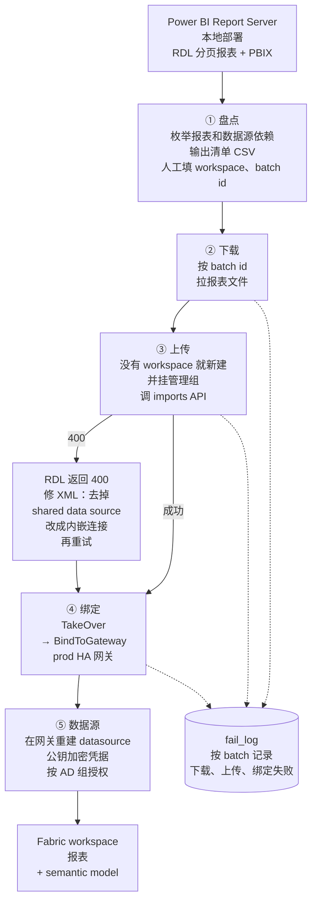
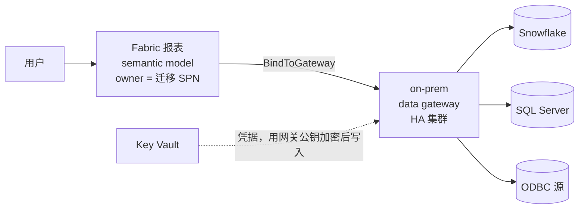

# Power BI Report Server → Fabric 迁移

> **简历原句：** Tech lead for CarMax's Fabric BI platform serving 6,000+ DAU: led the company-wide migration of 2,500+ Power BI reports into Fabric in a three-month cutover, and own its usage and cost observability layer; Quarterly Champion nominee
>
> **一句话：** 把本地 Power BI Report Server（PBIRS）上的 RDL 分页报表和 PBIX 报表，用一条 SPN 驱动、按 batch 分波次、失败可追可重跑的自动化流水线搬到 Fabric workspace，并把数据源通过 on-prem data gateway 接回去；按业务团队分批 cutover。
>
> *EN:* I automated moving paginated and Power BI reports from our on-prem Report Server into Fabric — a batch-driven, re-runnable pipeline run by a service principal that creates workspaces, imports reports, rebinds them to the on-prem gateway and recreates data source credentials — then cut over team by team.

> 这一条简历的后半句"own its usage and cost observability layer"单独写在 [06_fabric_observability.md](06_fabric_observability.md)。

---

## 1. 面试怎么讲

### 30 秒版本

> *EN:* Report Server has no "publish to cloud" button — the native path is opening each report in Desktop or Report Builder and republishing, and that still leaves gateway binding, credentials and permissions as manual work. I built a pipeline driven by a metadata inventory with a batch ID per wave: download from Report Server, import into Fabric workspaces, take ownership and bind to the HA data gateway, then recreate gateway data sources with encrypted credentials and group-based access. Failures at each stage are logged per batch, so any wave can be re-run. We cut over business teams in waves over about three months, and the platform now serves around six thousand daily users.

中文对照：PBIRS 没有"发布到云"的功能，原生方式是一个个在 Desktop / Report Builder 里打开再发布，而且网关绑定、凭据、权限还得手工做。我做了一条由清单驱动、每波一个 batch id 的流水线：从 PBIRS 下载 → 导入 Fabric workspace → 接管所有权并绑定 HA 网关 → 在网关上重建数据源、加密写入凭据、按 AD 组授权。每个阶段的失败按 batch 记录，任何一波都能重跑。按业务团队分波 cutover，大约三个月，平台现在日活约 6,000。

### 2 分钟版本

讲的顺序：为什么不能用原生方式 → 流水线怎么跑 → 难点在失败处理 → cutover 和结果。英文约 300 词，正常语速两分钟左右。每段先看英文怎么说，下面是同一段的中文。

**① 为什么不能用原生方式**

> *EN:* So we had to move all our reports off an on-prem Power BI Report Server into Fabric. The catch is, Report Server has no "publish to cloud" button. The native way is to open each report and republish it, one by one — and then you still have to rebind the gateway, re-enter credentials and set permissions by hand. With that many reports, that just wasn't going to work.

我们要把所有报表从本地的 Power BI Report Server 搬到 Fabric。麻烦在于，Report Server 没有"发布到云"的按钮。原生的办法是一个一个打开再重新发布，发完还得手工绑网关、重填凭据、配权限。报表这么多，这条路根本走不通。

**② 流水线怎么跑**

> *EN:* So I built a pipeline for it. It starts from an inventory of every report and its data sources, and each report gets a batch number. For each batch, it downloads the files, creates the Fabric workspace if it's not there, imports the reports, takes ownership, binds them to our high-availability gateway, and recreates the data sources with encrypted credentials. It all runs as one service principal with secrets in Key Vault, and permissions always go to AD groups, never to individual people.

所以我做了一条流水线。先盘点出每个报表和它的数据源，每个报表分一个批次号。每一批：下载文件，没有 workspace 就建，导入报表，接管所有权，绑到我们的高可用网关，再把数据源连同加密后的凭据重建出来。全程用一个 service principal 跑，密钥放 Key Vault，权限永远给 AD 组，不给个人。

**③ 难点在失败处理**

> *EN:* The interesting work was all in the failure paths. A lot of paginated reports pointed to shared data sources that don't exist in Fabric, so the import just failed. The pipeline rewrites the report XML to embed the connection, and retries. Binding a gateway only works if you own the report, so we take ownership first. And every stage logs failures per batch, so any batch can simply be rerun.

真正有意思的工作都在失败处理上。很多分页报表引用了 shared data source，Fabric 那边没有，导入直接失败。流水线会改写报表的 XML，把连接内嵌进去再重试。绑网关只有 owner 才能做，所以先接管所有权。每个阶段的失败都按批次记下来，哪一批出问题，直接重跑就行。

**④ Cutover 和结果**

> *EN:* Then we cut over team by team, over about three months. The biggest day was Merchandising and Service Ops — around a hundred and thirty reports at once. Usage grew with every wave, so I watched capacity the whole time, and that's actually what led me to own the cost observability side. Today the platform serves about six thousand people a day.

然后按业务团队一个一个切，前后大概三个月。最大的一天是 Merchandising 和 Service Ops，一次切了一百三十个左右的报表。每切一波用量就涨一截，所以我全程盯着 capacity，这也是后来我去负责成本可观测这块的起因。现在平台每天大概六千人在用。

### 数字和口径（被追问时别讲错）

| 说法 | 依据 | 备注 |
|---|---|---|
| 6,000+ DAU | FUAM 实测：工作日 DAU 峰值 6,010，近 30 天 MAU 12,935 | ✓ 一致 |
| 2,500+ reports | ⚠️ 本地 prod PBIRS 清单只有 1,078 个 item（881 RDL + 197 PBIX）；QA 清单 1,054 个 | 必须想好口径：是否把 QA、Power BI Service 原有内容、或其他团队自己迁的都算进去？租户现存 11,088 个 report，但那是迁移后的存量 |
| three-month cutover | Copilot 报告里的 cutover 时间线：3/9 首批 → 4 月 → 5 月 | ✓ 和简历一致。⚠️ 旧版总览文档写的是 "one-month cutover, replacing 3 planned contractors"，面试统一说三个月 |
| 目标 workspace | prod 清单分到约 30 个 workspace；最大的是 CAF（302 个） | 线上 288 个活跃 workspace 全部在专属 capacity 上 |
| Capacity | F128（188 个 workspace）、F64 × 2、遗留 P1 | capacity 绑定不在迁移代码里，在 Fabric admin 设置里做 |

---

## 2. Deep dive：5 个问题

### Q1. Why build your own automation instead of using Microsoft's tools?（为什么不用微软自带的方式？）

**中文要点**
- PBIRS 是被动宿主，没有出站的"publish to Fabric"。能发布的入口只有创作工具（Desktop、Report Builder）或 RDL Migration Tool，都是"拉下来再发布"。
- 原生方式缺的正是自动化补上的：批量（按 batch id）、RDL 和 PBIX 统一走 `/imports` API、`BindToGateway`、凭据重建、RBAC、失败自愈和追踪。
- 迁移脚本本身很薄（核心几个 Python 文件 + PowerShell helper），跑在 Azure DevOps pipeline 上，参数就是环境（qa / prod）和 batch id，所以任何人都能按 batch 重跑，不依赖某台机器。
- 到 2026 年 PBIRS → Fabric 仍然没有服务器端一键上云，这也说明自建是必要的。

**EN answer**
> Report Server is a passive host — there's no outbound publish. Every native path is pull-and-republish, one report at a time, and none of them handle gateway binding, data source credentials or permissions. A thin Python pipeline on Azure DevOps, parameterized by environment and batch ID, did all of that in bulk and could be re-run by anyone.

### Q2. What failed most often, and how did you handle it?（最常见的失败是什么？怎么处理？）

**中文要点**
- RDL 上传 400：通常是 RDL 引用了 PBIRS 上的 shared data source，Fabric 那边不存在。`XMLProcessor` 删掉 data source reference，按盘点时解析出的连接串（Data Source、Initial Catalog、provider）写进内嵌的 connection properties，存成临时文件重新上传，结果记为 Warning 而不是 Success，方便事后复核。
- Name conflict 按类型处理：PBIX 先 `CreateOrOverwrite`，失败再用 `Ignore`；RDL 先 `Abort`，遇到 409（已存在）再 `Overwrite`。这样重跑一波不会产生重复 item。
- 每个阶段（download / upload / bind）的失败写进 `fail_log`，最后导出 `fail_log_{batch_id}.json`；成功导入的 import id 存下来，bind 阶段从 import id 反查出 report / dataset id。
- 绑定失败的常见原因：数据源列表解析不出来，或者网关上找不到同名 datasource——这类进 fail log 人工处理。

**EN answer**
> The most common failure was paginated reports referencing a shared data source that doesn't exist in Fabric, so the import API returned 400. The pipeline rewrote the RDL XML to embed the connection details from our inventory and retried, marking it as a warning for review. Name conflicts had a per-type strategy so re-running a batch never created duplicates, and every stage wrote failures to a per-batch log.

### Q3. How do migrated reports still reach on-prem data sources?（迁过去的报表怎么连回本地数据源？）

**中文要点**
- 数据源不搬：报表在 Fabric 里通过 on-prem data gateway 回连 Snowflake、SQL Server 和 ODBC 源。prod 用 HA 网关集群 `PowerBIProd-Fabric-DataGateway-HA`，QA 用单独的网关。
- 先 `Default.TakeOver` 再 `Default.BindToGateway`：绑定网关、设凭据、配刷新都是 item owner 专属的操作，光是 workspace Admin 不够。每次绑定前都 take over 一次，保证可以重跑。副作用是原 owner 不再是 owner，这里正好——owner 本来就该是自动化 SPN。
- RDL 和 dataset 的绑定 API 不一样：dataset 传 `datasourceObjectIds`；RDL 要传 `bindDetails`，每个元素带数据源类型（Sql / ODBC / Snowflake，用一张映射表）和 datasource id。
- 网关数据源重建：从旧网关导出 datasource 定义和 `assignedUsers`，在目标网关重建；凭据从 Key Vault 取出，用网关的公钥（RSA modulus + exponent）做 RSA-OAEP 加密后提交，明文凭据不出现在请求里。
- `switch_gateway.py` 可以把一个 workspace 下所有 semantic model 一次切到另一个网关（例如 QA → prod HA）。

**EN answer**
> The data stays on-prem. Reports reach it through an HA on-prem data gateway. Binding to a gateway is an owner-only operation, so the pipeline first takes ownership with the service principal, then binds, which also makes it safe to re-run. Gateway data sources were recreated from an export of the old ones, with credentials pulled from Key Vault and encrypted with the gateway's public key before submission, and the original AD groups re-granted read access.

### Q4. How did you handle security and permissions?（安全和权限怎么做？）

**中文要点**
- 身份：迁移全程用一个 Fabric SPN（client credentials），client id / secret / tenant 都在 Key Vault；PBIRS 用 NTLM 服务账号，账号密码也在 Key Vault。数据源真实凭据（Snowflake 服务账号、各 ODBC 密码）同样来自 Key Vault。
- RBAC 全部基于 AD 安全组，不按人加：workspace 一建好就把 `KMX-APP-PBIRS-Admins` 加成 Admin；网关 datasource 把源侧原来的 AD 组重新授 Read，保留"谁能用这个源"。
- 终端用户的 Viewer / Member 访问是在这之上另配的 AD 组，不在迁移脚本里。
- 区分两个概念：item owner（`TakeOver` 改的）和 workspace 角色（RBAC），面试时这个区别能体现你真的做过。
- 迁移后的治理发现：通过 FUAM 查到只有约 22.6% 的报表直接挂了 AD 组（很多靠 workspace 角色继承），这是后续治理要补的点。

**EN answer**
> Everything ran as one service principal whose secrets lived in Key Vault, and permissions were always security groups — an admin group on every new workspace and the original AD groups on each gateway data source. One distinction that matters in practice: item ownership, which binding requires, is separate from workspace roles.

### Q5. How did you plan the cutover to minimize disruption?（cutover 怎么安排，才能不影响业务？）

**中文要点**
- 先在 QA 环境跑通同一条流水线（QA 有自己的 PBIRS、网关、清单），再上 prod。
- 按业务团队分 batch：一个 batch 对应一个团队或一组 workspace，团队确认验证通过后才切下一个。时间线（来自 Copilot CU 报告）：3/9 CEC 7 个报表首批；3/18 Snowflake 相关 18 个；3/24 Merchandising + Service Ops 133 个（最大一批）；3/26 Workforce Management 22 个；4 月 Technology Solution Center、Sales、HR；5 月 Compliance、Marketing 等。
- 盯 capacity：cutover 带来用量增长，Copilot CU 从 3/9 的约 1.7 万/天涨到 3/24 之后的 150 万/天左右；F64 利用率 54–71%，有余量，但提前给后续批次预留了 capacity。
- ⚠️ 下面这些本地文档没有，面试前回忆：每个团队的验证标准（数字对比？刷新成功？）、旧 PBIRS 是否保留只读一段时间、回滚方式、用户沟通方式。

**EN answer**
> We ran the full pipeline in QA first, then cut over in production team by team, each batch mapped to a business team that signed off before the next one. The largest wave was Merchandising and Service Ops — about 130 reports in one day. Because usage grows with every wave, I tracked capacity utilization throughout and reserved headroom for the later teams.

---

## 3. 参考文档

| 想复习什么 | 文档 |
|---|---|
| 迁移五阶段、RBAC、TakeOver、网关、为什么不能直接 publish、简历映射 | [CarMax_Fabric_BI_Platform_Overview](</Users/wqeq/Desktop/external_project/dape_project_sync_0916/fabric_study_doc/CarMax_Fabric_BI_Platform_Overview.md>) |
| cutover 时间线（第 3 节）和 capacity 影响 | [Copilot_Consolidated_Report_EN](</Users/wqeq/Desktop/external_project/dape_project_sync_0916/fabric_study_doc/Copilot_Consolidated_Report_EN.md>) |
| 报表 AD 组覆盖率 | [Report_AD_Group_Assignment_Analysis](</Users/wqeq/Desktop/external_project/dape_project_sync_0916/fabric_study_doc/Report_AD_Group_Assignment_Analysis.md>) |
| 迁移代码 | 仓库 [dataanalyticsplatform-PowerBI-Fabric-Migration](</Users/wqeq/Desktop/external_project/dape_project_sync_0916/dataanalyticsplatform-PowerBI-Fabric-Migration/>)：`download_main.py`、`upload_main.py`、`bind.py`、`switch_gateway.py`、`import_data_sources.py`、`create_data_source.py`、`migration_tools/fabric_api.py`、`azure-pipelines.yml` |
| 报表清单 | 同仓库 `metadata/reports_metadata_prod.csv`（1,078 行）、`reports_metadata_qa.csv` |

---

## 4. 这个项目是干什么的

**它是一条一次性但可重复运行的迁移流水线。** 输入是一份报表清单（每行一个报表：名字、类型、数据源、连接串、目标 workspace、batch id），输出是 Fabric 里的 workspace、报表、semantic model 和网关数据源。整个流水线在 Azure DevOps 上运行，参数是环境和 batch id。

### 五个阶段

### 迁移后报表怎么拿到数据

### 用到的 API 一览

| 动作 | API | 细节 |
|---|---|---|
| 枚举和下载报表 | PBIRS REST：`CatalogItems`、`DataSources`、`catalogitems({id})/Content/$value` | NTLM + Key Vault 里的服务账号 |
| 建 workspace、挂管理组 | Fabric `POST /workspaces`、加 role assignment | 管理组为 Admin |
| 导入报表 | Power BI `POST /groups/{ws}/imports?nameConflict=...` | PBIX：CreateOrOverwrite → Ignore；RDL：Abort → 409 时 Overwrite |
| 接管所有权 | `Default.TakeOver` | 绑定前每次都做，保证可重跑 |
| 绑定网关 | `Default.BindToGateway` | dataset 传 datasource id；RDL 传带类型的 `bindDetails` |
| 重建数据源 | Gateway datasource API + 网关 `publicKey` | RSA-OAEP 加密凭据；按 AD 组授 Read |
