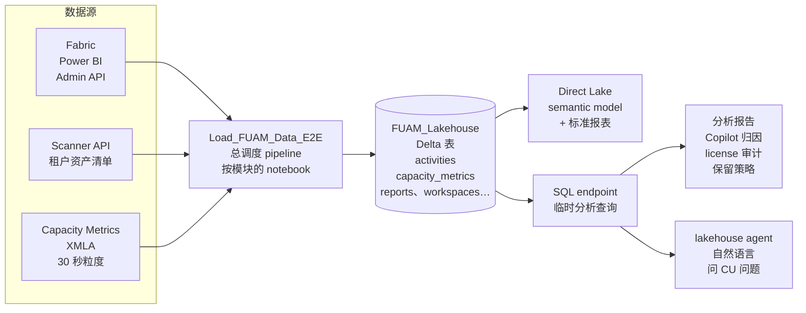
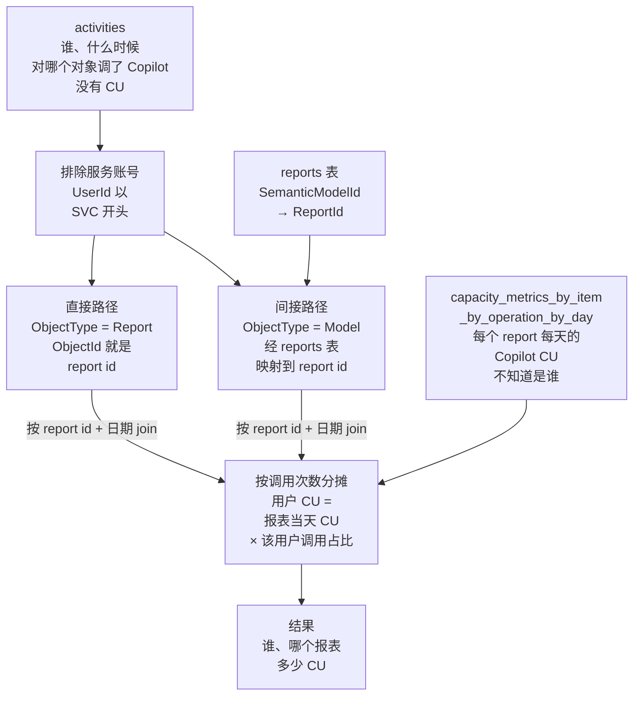

# Fabric Usage & Cost Observability（FUAM）

> **简历原句（后半句）：** …and own its usage and cost observability layer
>
> **一句话：** 在 Fabric 租户上部署、运维并扩展 FUAM（微软 fabric-toolbox 的社区加速器），把 activity log、capacity metrics 和 Scanner API 的资产清单落进一个 lakehouse，然后用它回答管理层的具体问题：谁在用、什么在烧 CU、钱该怎么省。
>
> *EN:* I own the usage and cost observability layer for our Fabric tenant. It's built on FUAM, a Microsoft community accelerator, which lands activity logs, capacity metrics and tenant inventory into a lakehouse — and I use it to answer concrete questions like who is driving capacity, which reports are expensive, and where we can save.

> ⚠️ **口径：FUAM 不是你从零写的。** 说"deployed, operate and extended FUAM"，重点讲你用这份数据做出的分析和决定。把别人写的加速器说成自己构建，被追问 notebook 细节时会穿帮。

---

## 1. 面试怎么讲

### 30 秒版本

> *EN:* Fabric has monitoring spread across the admin portal, the capacity metrics app and activity logs, and none of them answer business questions on their own. We deployed FUAM, which pulls everything into a lakehouse with Direct Lake reports on top. The value I added was the analysis layer. The best example: Copilot was suddenly consuming over twenty percent of our F64 capacity. The cost table knows which report burned CU but not who; the activity table knows who but has no cost. I joined them through the report and semantic model IDs, allocated CU proportionally, and found five scorecard reports drove half the cost because their semantic models were too large. That turned into a targeted fix instead of turning Copilot off for everyone.

中文对照：Fabric 的监控散在 admin portal、Capacity Metrics App 和 activity log 里，单独哪个都答不了业务问题。我们部署了 FUAM，把这些都拉进 lakehouse，上面是 Direct Lake 报表。我增加的价值在分析层。最好的例子：Copilot 突然吃掉 F64 capacity 超过 20% 的 CU；CU 表知道哪个报表花了钱但不知道是谁，activity 表知道是谁但没有成本。我用 report 和 semantic model 的 id 把两张表接起来、按调用次数分摊，发现 5 个 scorecard 报表占了一半成本，原因是 semantic model 太大。结果是针对性地瘦身，而不是全员关掉 Copilot。

### 2 分钟版本

讲的顺序：为什么需要这一层 → 底座是什么、我负责什么 → Copilot 归因 → 其他决定。英文约 300 词，正常语速两分钟左右。每段先看英文怎么说，下面是同一段的中文。

**① 为什么需要这一层**

> *EN:* After the migration, we had about six thousand daily users, close to three hundred workspaces and several capacities. And leadership started asking very practical questions: who's using what, what's eating our capacity, and are we paying for licenses we don't need? The native tools give you raw numbers, but they don't really answer those questions.

迁移完以后，日活六千左右，将近三百个 workspace，好几个 capacity。领导开始问很实际的问题：谁在用什么？什么在吃我们的 capacity？license 是不是有浪费？原生工具能给你原始数字，但回答不了这些问题。

**② 底座和我负责的部分**

> *EN:* So we deployed FUAM. It's a Microsoft community accelerator that pulls activity logs, capacity metrics and the tenant inventory into a lakehouse. Just to be clear, I didn't write FUAM. What I own is running it, understanding its data, and the analysis on top.

所以我们部署了 FUAM，这是微软的一个社区加速器，会把 activity log、capacity 指标和租户资产清单都拉进一个 lakehouse。先说清楚，FUAM 不是我写的；我负责的是把它跑起来、搞懂它的数据，以及在上面做分析。

**③ Copilot 归因**

> *EN:* The best example is Copilot. All of a sudden it was using over twenty percent of our F64 capacity, and the first reaction was "let's just turn it off". The problem is, the cost table knows which report burned the CU, but not who; the activity table knows who, but has no cost. So I joined them through the report and semantic model IDs, and split each report's cost by who called it. One service account looked like sixty percent of the activity — but when I dug in, it was Copilot's own background indexing, about one percent of the cost, so I took it out. In the end, five scorecard reports drove half the cost, because their semantic models were huge. So the fix was to slim down those models, not to turn Copilot off for everyone.

最好的例子是 Copilot。它突然吃掉了 F64 capacity 两成多，大家第一反应是"关掉算了"。问题是，成本表知道是哪个报表烧的 CU，但不知道是谁；activity 表知道是谁，但没有成本。我就通过 report 和 semantic model 的 id 把两张表接起来，按谁调用了多少次来分摊每个报表的成本。有个服务账号看起来占了 60% 的调用，查下去发现是 Copilot 自己的后台索引，只占 1% 左右的成本，我就把它排除了。最后发现 5 个 scorecard 报表占了一半成本，原因是它们的 semantic model 太大。所以办法是给这几个模型瘦身，而不是全员关掉 Copilot。

**④ 其他决定**

> *EN:* The same data drove smaller calls too — like which viewers only need a free license, and keeping nine months of history once I showed it costs about two cents a month. And I packaged the table knowledge into a skill for our lakehouse agent, so other people can just ask these questions themselves.

同一份数据也推动了一些小决定，比如哪些只看报表的人用免费 license 就够，还有历史数据保留 9 个月——我算出来每个月也就多两美分左右。我还把这些表的知识做成了 lakehouse agent 的一个 skill，别人想问这类问题，可以直接自己问（见 [07_react_agent_platform.md](07_react_agent_platform.md)）。

### 数字和口径（被追问时别讲错）

| 说法 | 依据 | 备注 |
|---|---|---|
| Copilot 约占 F64 CU 的 20–22%，约 1,070 万 CU | 2026-01-23 到 04-02 的数据 | 其中 Report 类 92.4% 可归因到用户 |
| 455 个去重终端用户用过 Copilot | 同上 | 3 月新增 389 个，和 cutover 同步 |
| Top 5 报表占 Copilot Report CU 的 52%，每次请求是微软基线（400 CU-秒）的 6–11 倍 | 同上 | 原因：semantic model schema 太大，input token 多 |
| 服务账号占 Copilot activity 的 60%，但只占 1.3% CU | 同上 | 是 Copilot 后台的 schema indexing |
| F64 整体利用率 54–71% | 同上 | Copilot 没造成容量不足 |
| 归因覆盖：直接路径 90.8%，间接路径 13.4%，两者有重叠 | 归因方法 | 微软没有官方的逐条 Copilot CU 归因 API，这是基于数据结构的合理推断 |
| 日活峰值 6,010，MAU 12,935，288 个 workspace | 2026-09-15 lakehouse 实测 | 也是迁移那条简历的证据 |

---

## 2. Deep dive：5 个问题

### Q1. What did you actually build versus adopt?（哪些是你做的，哪些是现成的？）

**中文要点**
- 现成的：FUAM 的 pipelines、notebooks、lakehouse 表结构、标准报表。按模块抽取：Capacities、Workspaces、Capacity Refreshables、Capacity Metrics、Activities、Active Items、Inventory（Scanner API）、Tenant Settings、Git Connections 等，由 `Load_FUAM_Data_E2E` 总调度。
- 我做的：部署和升级（有 how-to 文档）、运维、数据行为的摸底（哪些表 MERGE、哪些 APPEND、历史会不会丢）、保留策略、以及所有分析：Copilot 归因、服务账号调查、license 审计、AD 组覆盖率、RLS 现状、pipeline 成本、计费规则变更评估。
- 我摸出来的几个数据坑，能体现真用过：
  - activities 表 144 列，Fabric 原生 item（pipeline、notebook）的名字和 id 不在 `ArtifactName / ItemId`（永远是 NULL），而在 `ObjectDisplayName / ObjectType`，`RequestId` 是 pipeline run id。
  - CU 只有按天聚合，没有逐次 run 的 CU。
  - `TotalCUUsagePercentage` 是每 30 秒的瞬时值，跨全期直接平均会被空闲点拉低；评估容量压力要看 P95、峰值和拒绝率。

**EN answer**
> The extraction pipelines and the lakehouse schema come from FUAM. What I own is running it, understanding its data behavior, and the analysis on top. A few things you only learn by using it: Fabric-native items don't populate the artifact columns in the activity table — they're in the object fields — CU is only available as a daily aggregate, and averaging the 30-second utilization percentage hides your peaks, so I look at P95 and rejections instead.

### Q2. Copilot was eating about 20% of capacity. How did you attribute the cost to users and reports?（Copilot 吃掉 20% capacity，怎么把成本归到人和报表？）

**中文要点**
- 难点：`capacity_metrics_by_item_by_operation_by_day` 知道哪个 Report 那天花了多少 Copilot CU，但不知道是谁触发的；`activities` 知道谁对哪个对象调了 Copilot，但没有 CU。两张表不能直接 join。
- 方法：两条路径接起来，再按调用次数比例分摊。
  - 直接路径：用户的 `RequestCopilot` 记录 `ObjectType=Report`，`ObjectId` 就是 report id，直接对上 CU 表的 `ItemId`。
  - 间接路径：`ObjectType=Model` 时 `ObjectId` 是 semantic model id，先查 reports 表的 `SemanticModelId → ReportId`，再对上 CU。
  - 公式：用户 A 某天在报表 X 上的 CU = X 那天的 Copilot CU × (A 的调用次数 / 所有终端用户在 X 上的调用次数)。
  - 排除服务账号（`UserId NOT LIKE 'SVC%'`），原因见 Q3。
- 结论：Top 5 报表（Production Dashboard Trend、几个 Merchandising Scorecard、Vehicle Quality Score）占 52%，每次请求 2,400–4,300 CU-秒，是微软典型值 400 的 6–11 倍。Copilot CU 大致按 input token × 100 + output token × 400（每千 token）计，schema 越大 input token 越多。
- 建议和优先级：P0 精简这 5 个报表的 semantic model（去掉无用的表、列、measure），预计单次 CU 降一半以上；P1 只对 Merchandising Scorecard 系列关 Copilot、联系 Top 用户了解场景；P2 只对高价值报表开 Copilot、给后续 cutover 预留 capacity。**不需要**全员关 Copilot，也不需要扩容。
- 诚实的边界：这是推断方法，不是官方逐条归因；约 9% 的 CU 没覆盖到。

**EN answer**
> The cost table knows which report consumed Copilot CU but not who; the activity table knows who but has no cost. I linked them on report ID, and for activities logged against a semantic model, through the model-to-report mapping. Then I allocated each report's daily CU by each user's share of calls. Five scorecard reports drove fifty-two percent of the cost at six to eleven times Microsoft's typical per-request cost, because their semantic models sent huge schemas as context. So the recommendation was to slim those models, not disable Copilot. I was explicit that this is an inference — Microsoft doesn't expose per-request Copilot attribution.

### Q3. A service account showed 60% of Copilot activity. How did you figure out whether it mattered?（服务账号占 60% 的 Copilot 调用，怎么判断它重不重要？）

**中文要点**
- 现象：`SVCPBIFABRIC` 有 93,400 次 Copilot activity，占 60%，但没有已知 use case。如果按调用次数把它纳入分摊，它会被算成 94% 的 CU——结论完全被扭曲。
- 调查证据：
  - 它的 `ObjectType` 99.99% 是 Model（semantic model），终端用户主要是 Report。
  - 只有服务账号访问的 model 不产生 Report 类 CU。
  - 行为分两种：每天 UTC 0 点、6 点、10 点固定调 8 个 model（约 223 次/天，像定时任务）；白天 11–14 点随终端用户使用波动（约 3,000–4,000 次/天）。
  - 非工作时间几乎只有它在调，同一小时同一 model 大量调用而终端用户为 0。
  - AI Function Evaluation 类 CU 的 93% 出现在只有服务账号活动的日子。
- 结论：这是 Copilot 后台的 schema indexing，只产生 1.3% 的 CU，从归因里排除；**不要**收回它的权限，关掉反而可能降低 Copilot 对 semantic model 的理解质量。
- 顺带一个细节：所有 Copilot 活动的 UserAgent 都是 "Spark"，那是 Copilot 后端的特征，不代表从 notebook 发起，不能拿 UserAgent 区分。

**EN answer**
> If I'd allocated by raw call count, that one service account would have absorbed ninety-four percent of the cost and the analysis would have been useless. So I looked at its behavior: it almost only touched semantic models, ran on a fixed schedule at night, and models only it touched produced no report-level CU. It was Copilot's backend schema indexing — about one percent of the cost. I excluded it from attribution and recommended leaving it enabled, since it likely improves Copilot's answers.

### Q4. The activity API only keeps about 28 days. How do you keep history, and how long do you retain it?（activity API 只保留约 28 天，历史怎么留？保留多久？）

**中文要点**
- 刷新策略按表不同：
  - MERGE（按主键 upsert，历史保留）：capacities、workspaces（删除的标记 `fuam_deleted=True`，软删除）、三张 capacity metrics 表（每次从 XMLA 拉滚动 3 天窗口 merge 进全量历史）、refreshables 系列等。
  - APPEND + watermark：activities，每次只追加新的，所以即使源 API 只保留约 28 天，lakehouse 里的历史也不会丢。
- 保留策略：一开始没有任何保留策略，lakehouse 会无限增长。我比较了 6 个月和 9 个月：9 个月多出约 1 GB Delta 存储，OneLake 费用约每月 $0.02，不到 F64 预留费用的 0.001%；查询基本都按日期过滤，性能影响很小。建议 9 个月，优先清理 activities 和 custom_activity。
- 当时规模：71 张表、约 580 万行、4 个 capacity、258 个 workspace、约 15,000 个活跃 item、约 113 天数据。

**EN answer**
> It depends on the table. Inventory and capacity metrics are merged on a key, with soft deletes, and metrics re-pull a rolling three-day window. Activities are appended with a watermark, so our history outlives the API's roughly twenty-eight-day window. For retention I compared six versus nine months: the extra storage was about two cents a month, so I recommended nine months — the decision was cheap once it was quantified.

### Q5. What decisions did this data actually drive?（这些数据推动了哪些决定？）

**中文要点**
- Copilot：针对 Top 5 报表瘦身 semantic model，而不是全员关；判断不需要扩容（利用率 54–71%），但为后续 cutover 批次预留 capacity。
- License：按行为分类用户（viewer / creator / sharer）。规则：在 Premium / Fabric capacity 上只看报表的人 Free license 就够；在 shared capacity 上任何活动都要 Pro；创建、分享、定时刷新永远要 Pro。用这个找出可能只需要 Free 的人。边界：activity 数据只能说明"需要什么"，不能说明"实际持有什么"，要再用 Graph `licenseDetails` 交叉核对。
- 治理：报表 AD 组覆盖率只有约 22.6%（Power BI 报表 34.5%、分页报表 15.3%）；RLS semantic model 29 / 160。FUAM 只知道 model 是否开了 RLS（两个布尔值），不知道 role 名、DAX filter 和 role 成员——这些在 TOM 里，Scanner API 不返回。
- 计费规则变更（2026 年 8 月）：Warehouse / SQL endpoint 从按查询 CPU 时间计费改成按 Virtual Node 运行时间（2 CU/vCore → 0.53 CU/vCore，但空闲时间也计费、每次最低 1 分钟）。我们的负载是 FUAM SQL endpoint 的密集查询（日均约 2,100 CU），属于 dense workload，预计 CU 下降，不需要动作，只需前后对比。

**EN answer**
> The Copilot analysis turned a "turn it off" conversation into a targeted model clean-up and a capacity plan for the remaining cutover waves. The license audit identified viewers on dedicated capacity who only need free licenses, with the caveat that we cross-check actual assignments through Graph. And it surfaced governance gaps — only about a quarter of reports were secured by AD groups directly.

---

## 3. 参考文档

| 想复习什么 | 文档 |
|---|---|
| FUAM 在整个平台里的位置、线上实测数字 | [CarMax_Fabric_BI_Platform_Overview](</Users/wqeq/Desktop/external_project/dape_project_sync_0916/fabric_study_doc/CarMax_Fabric_BI_Platform_Overview.md>) |
| Copilot 归因完整报告（含 SQL） | [Copilot_Consolidated_Report_EN](</Users/wqeq/Desktop/external_project/dape_project_sync_0916/fabric_study_doc/Copilot_Consolidated_Report_EN.md>)（中文版 [Copilot_Consolidated_Report](</Users/wqeq/Desktop/external_project/dape_project_sync_0916/fabric_study_doc/Copilot_Consolidated_Report.md>)） |
| 归因方法单独版 | [Copilot_CU_Attribution_Report](</Users/wqeq/Desktop/external_project/dape_project_sync_0916/fabric_study_doc/Copilot_CU_Attribution_Report.md>) |
| 服务账号调查 | [SVCPBIFABRIC_Copilot_Investigation](</Users/wqeq/Desktop/external_project/dape_project_sync_0916/fabric_study_doc/SVCPBIFABRIC_Copilot_Investigation.md>) |
| Pro license 审计 | [Fabric_Pro_License_Usage_Audit](</Users/wqeq/Desktop/external_project/dape_project_sync_0916/fabric_study_doc/Fabric_Pro_License_Usage_Audit.md>) |
| 表的刷新行为 | [FUAM_Data_Refresh_Behavior](</Users/wqeq/Desktop/external_project/dape_project_sync_0916/fabric_study_doc/FUAM_Data_Refresh_Behavior.md>) |
| 保留策略 6 vs 9 个月 | [FUAM_Lakehouse_Retention_Policy_Analysis](</Users/wqeq/Desktop/external_project/dape_project_sync_0916/fabric_study_doc/reports/FUAM_Lakehouse_Retention_Policy_Analysis.md>) |
| pipeline 成本和 activities 字段坑 | [FUAM_Pipeline_Cost_Analysis](</Users/wqeq/Desktop/external_project/dape_project_sync_0916/fabric_study_doc/FUAM_Pipeline_Cost_Analysis.md>) |
| Warehouse 计费规则变更 | [Fabric_Warehouse_CU_Metering_Change_Aug2026](</Users/wqeq/Desktop/external_project/dape_project_sync_0916/fabric_study_doc/reports/Fabric_Warehouse_CU_Metering_Change_Aug2026.md>) |
| 表结构总览、架构、部署 | [FUAM_Core_SM_Tables_Summary_EN](</Users/wqeq/Desktop/external_project/dape_project_sync_0916/fabric_study_doc/FUAM_Core_SM_Tables_Summary_EN.md>)、[FUAM_Architecture](</Users/wqeq/Desktop/external_project/dape_project_sync_0916/fabric_study_doc/media/documentation/FUAM_Architecture.md>)、[How_to_deploy_FUAM](</Users/wqeq/Desktop/external_project/dape_project_sync_0916/fabric_study_doc/how-to/How_to_deploy_FUAM.md>) |
| RLS 和 AD 组覆盖 | [fuam_rls](</Users/wqeq/Desktop/external_project/dape_project_sync_0916/fabric_study_doc/fuam_rls.md>)、[Report_AD_Group_Assignment_Analysis](</Users/wqeq/Desktop/external_project/dape_project_sync_0916/fabric_study_doc/Report_AD_Group_Assignment_Analysis.md>) |

---

## 4. 这个项目是干什么的

**它是 Fabric 租户的"管理数据仓库"。** 一个专门的 Fabric workspace 里跑着 FUAM：调度 pipeline 每天调各种 admin API，把结果落进 `FUAM_Lakehouse`；Direct Lake semantic model 直接读这些 Delta 表，标准报表和临时 SQL 查询都基于它。我的分析报告、license 审计、lakehouse agent 都从这里取数。

### 数据从哪来、到哪去

### Copilot CU 归因怎么把两张表接起来

### 主要的表

| 表 | 内容 | 刷新方式 |
|---|---|---|
| `activities` | 租户活动日志（144 列） | APPEND + watermark，历史保留 |
| `capacity_metrics_by_timepoint` | 每 30 秒的 capacity 利用率 | 滚动 3 天窗口 MERGE |
| `capacity_metrics_by_item_by_operation_by_day` | 每个 item 每天每种操作的 CU | 滚动 3 天窗口 MERGE |
| `reports`、`semantic_models`、`workspaces` 等 | Scanner API 资产清单 | MERGE，删除的做软删除标记 |
| `item_users` | item 级权限（按 User / Group / App） | 随清单刷新 |
