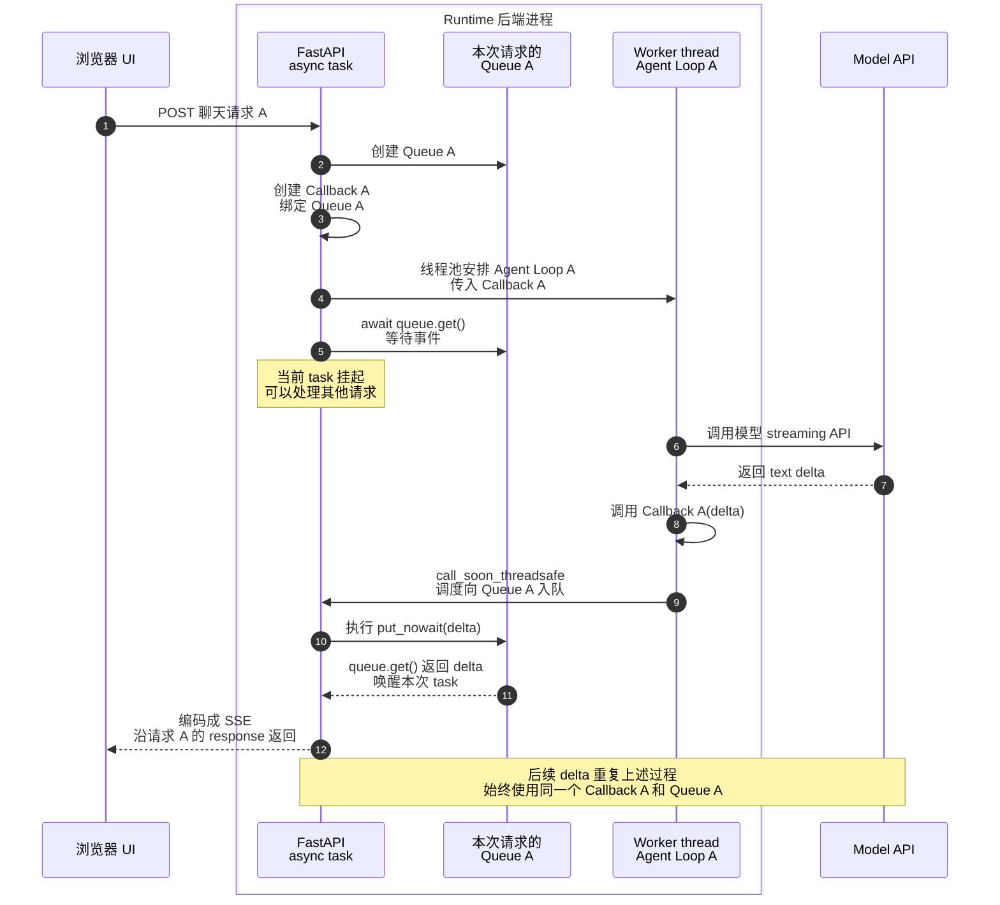
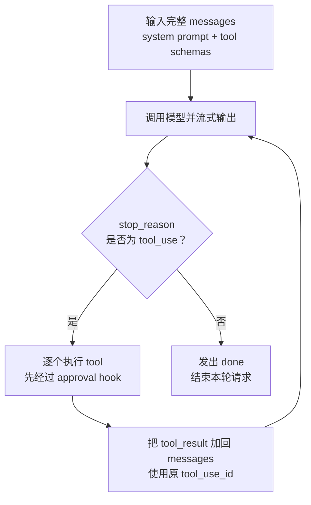
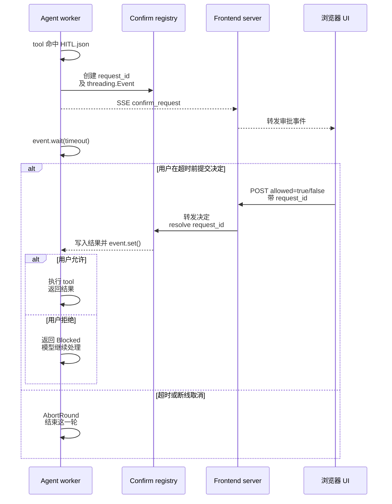
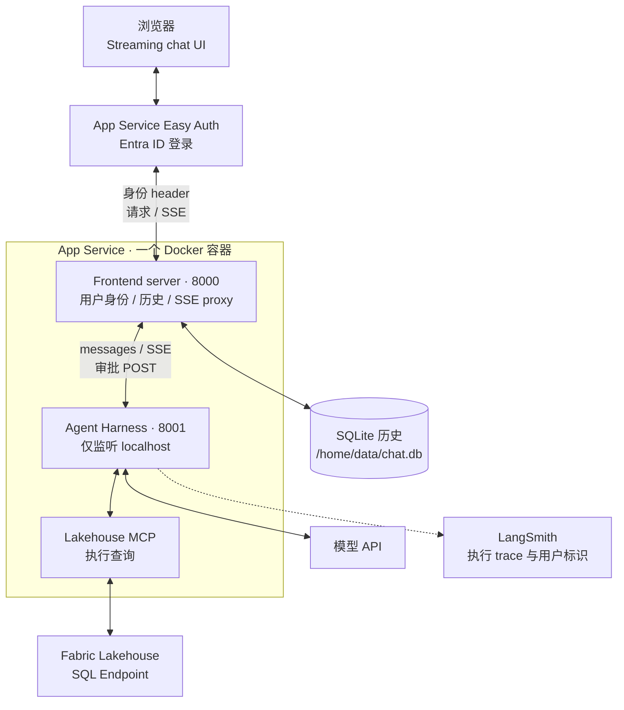

# 内部面试版：自研 ReAct Agent Harness 与 Streaming UI

**主线是：发现团队做 agent 时的重复需求，做出共用 harness 和 UI，再用 FUAM 展示具体实现。** 2026 年初，platform engineering 和 data engineering 团队都在探索 agent，你希望大家接入自己的 prompt、skills 和 tools，就能复用 streaming、chat history、tool approval、SSO 和 tracing。

本文以最新的 `fuam-agent/` 为技术依据。`agent_runtime_new/` 是通用多 agent demo，用来说明同一套 harness 如何接不同配置；两个版本的 ReAct loop、SSE 桥接和 HITL 机制相同。这里的 ReAct 指 tool-use loop；UI 实际用 HTML/CSS/vanilla JavaScript。

项目范围统一说明：你做了 Fabric Observability Agent 和 Ops Agent 两个内部 chatbot，最终没有正式上线。FUAM 源码能支持前一个用例的技术说明；Ops Agent 的业务范围依据你的说明和简历。以下部署内容来自代码和配置，本次没有验证 Azure 当前运行状态。

## 两分钟开场：建议直接练这一版

英文 237 词。按“为什么做 → 共用能力 → Azure 部署与登录 → 两个用例”讲，具体实现留给追问。

> In early 2026, platform engineering and data engineering teams were starting to explore agents. Things were moving fast, and I saw a common need: teams wanted to bring their own prompts, skills, and tools without rebuilding the runtime and chat UI each time.
>
> So I built a shared ReAct harness and a chat UI that saved conversations and streamed responses. Each agent used the same core loop: the model called tools, read the results, and continued until it had an answer. Teams supplied the domain knowledge, while the platform handled history, streaming, tool approvals, and tracing.
>
> I built the streaming path using SSE. The runtime emitted text, tool calls, and approval requests, and a frontend server forwarded those events to the browser. Tools configured to require approval waited for the user before running. I used LangSmith to trace model calls, tool calls, and approval waits.
>
> For the FUAM version on Azure, I packaged the frontend and runtime into one Docker image, pushed it to Azure Container Registry, and used a Linux App Service to run it. I configured the infrastructure with Bicep and used Easy Auth with Entra ID for sign-in. The frontend read the authenticated user's identity and used it to keep chat history separate by user.
>
> I built two internal chatbot use cases around this: a Fabric Observability Agent for usage and cost questions, and an Ops Agent for platform health questions and standup summaries.

### 中文怎么记

2026 年初，我们 platform engineering 和 data engineering 团队都开始探索 agent。我发现一个共同需求：大家想接入自己的 prompt、skills 和 tools，不想每次都重写 runtime 和聊天 UI。

所以我用 Python 做了一套共用的 ReAct harness，也写了 streaming UI。不同 agent 共用一个 loop：模型调用 tool，读取结果，再继续。团队负责业务知识，平台负责历史、streaming、审批和 tracing。

流式输出用 SSE：runtime 发出文字、tool call 和审批事件，frontend server 转发给浏览器。配置成需要审批的 tool，要等用户同意才执行。模型、tool 和审批等待都能在 LangSmith 里追踪。

FUAM 的 Azure 部署这块，我把 frontend 和 runtime 打进一个 Docker image，推到 ACR，用 Linux App Service 运行。基础设施用 Bicep 配置，登录交给 Easy Auth 和 Entra ID。frontend 读取登录用户的身份，按用户分开存取聊天历史。

后来我围绕这套东西做了两个内部 chatbot：Fabric Observability Agent 查使用量和成本，Ops Agent 查平台健康情况、生成 standup summary。

### 对方只给你 30 秒时

> In early 2026, our platform and data engineering teams were experimenting with agents, and I saw a lot of repeated work around the runtime and chat UI. I built a shared ReAct harness where teams could bring their prompts, skills, and tools, and reuse streaming, history, approvals, and tracing. I also built two chatbot use cases for Fabric observability and platform operations. These were internal prototypes.

## 技术追问一：Streaming 到底怎么实现，SSE 在哪里嫁接？

**每次聊天请求创建自己的 queue 和 callback，后端在线程池中执行同步 agent loop。agent loop 读到模型事件后调用 callback；FastAPI 的异步部分从 queue 取出事件，编码成 SSE 返回。**

这几段连接代码就是前面所说的 streaming bridge，它不是另一个服务或插件。Queue 是 Python 自带的对象，没有自己的执行线程。

### 按调用顺序看一遍

下面省略 frontend server 的转发，专门画 runtime 内部的同步／异步衔接。FastAPI 一栏包含 event loop 上执行的调度动作和本次请求的 async task；Queue 一栏只是对象，不是执行线程。创建状态与读 queue 都在 event loop 这边，agent loop 跑在 worker thread 中。



- **1–4：创建并绑定。** 聊天请求进入 runtime，`chat_stream()` 创建 Queue A、Callback A，再把 Callback A 传给线程池中执行的 Agent Loop A。线程可以复用，不一定每次新建。
- **5：等待事件。** 本次 async task 等待 Queue A；queue 为空时挂起，让 event loop 处理其他请求。
- **6–8：读取模型输出。** agent loop 通过 SDK 读取模型 stream，收到 delta 后主动调用 Callback A。callback 自己不监听模型。
- **9–10：跨线程入队。** Callback A 在 worker 中运行，通过 `call_soon_threadsafe` 请 event loop 执行 `queue.put_nowait(delta)`。
- **11–12：取出并发送。** 入队动作唤醒等待的 task。`chat_stream()` 取出 event 并 yield，route 的 `EventSourceResponse` 编码为 SSE。

源码中的 `chat_stream()` 是 **async generator**：它由 `async def` 定义，内部用 `yield` 逐个产出事件。endpoint 使用 `async for` 消费它，不是只 `await` 一次拿到完整结果。

### call_soon_threadsafe 和 put_nowait 分别做什么？

实际连接两边的是这行代码：

```python
loop.call_soon_threadsafe(queue.put_nowait, evt)
```

| 部分 | 作用 | 在哪里执行 |
|---|---|---|
| `call_soon_threadsafe(...)` | 安全地把一个函数调用安排到目标 event loop，并唤醒 loop 处理它；不等待那个函数执行完 | 由 worker thread 调用 |
| `queue.put_nowait(evt)` | 把事件立即放进 queue，不等待空位；唤醒等待取数据的 task | 由 event loop 执行 |
| `await queue.get()` | 有事件就取出；没有就挂起当前 task，等事件到来 | 本次请求的 async task |

可以把第一行读成：**“event loop，请你稍后执行 `queue.put_nowait(evt)`。”**

注意这里传的是 `queue.put_nowait` 这个函数和参数 `evt`，没有在 worker 里直接调用它。`asyncio.Queue` 不是 thread-safe 的，所以把实际入队动作安排回 event loop；`put_nowait` 本身并不提供跨线程安全保证。

`nowait` 指不等待 queue 出现空位，不是跳过 event loop 调度，也不是直接把数据发到网络。当前 queue 由 `asyncio.Queue()` 创建，没有容量上限；如果改成有界 queue，满了以后 `put_nowait` 会抛 `QueueFull`，需要额外处理。

Queue 本身不会主动发送东西。**是 FastAPI 侧的 async generator 一直在 `await queue.get()`，取到事件后继续执行并 yield。**

### 为什么 A 的输出不会进入 B 的 response？

每次调用 `chat_stream()` 都有自己的局部变量。Callback A 通过 closure 捕获 Queue A；Agent Loop A 拿到的就是 Callback A。本次 async generator 也只读取 Queue A，再沿请求 A 自己的 HTTP response 返回。

| 请求 | agent loop 使用的 callback | callback 写入哪里 | SSE 从哪里读 |
|---|---|---|---|
| A | Callback A | Queue A | Queue A |
| B | Callback B | Queue B | Queue B |

不同请求可以进入同一个 endpoint、共享同一个 engine 和线程池，但不会因此共享局部 queue 和 callback。正常输出不需要再根据 user ID 分发一次。线程复用时，下一次请求仍会创建新状态；hooks 和 Todo 的 thread-local 绑定也会在执行结束后清理。

事件不串流，并不等于资源完全独立。线程池默认最多 64 个 agent threads，审批等待也占线程；模型额度、MCP 和机器资源共享，负载大时仍会排队。无界 queue 在消费变慢时也可能积压事件。这一说明针对多个用户／页面；同一页面仍有 `currentSession` 等共享 UI 状态。

### frontend server 和浏览器各做什么？

实际还有一跳：浏览器 → frontend server → runtime。frontend 用 `httpx.AsyncClient.stream()` 调 runtime，逐块读取 `r.aiter_raw()`，由 `StreamingResponse` 原样转发。每次请求有自己的 upstream response；共享 httpx client 不等于共享 response body。

浏览器用 POST `fetch()` 发送 messages，再通过 `response.body.getReader()` 持续读字节。`TextDecoder` 以 streaming 模式处理 UTF-8，buffer 按空行拆完整 SSE frame，半帧保留到下次读取。**网络 chunk 和 SSE event 不是一一对应的。**

| SSE 事件 | UI 做什么 |
|---|---|
| `text_delta` / `text_stop` | 追加文字、渲染 Markdown、关闭当前 text block |
| `tool_call` / `tool_result` | 展示 tool 卡片，重建配对的历史 messages |
| `confirm_request` | 展示 Allow / Deny；决定经独立 confirm POST 回传 |
| `thinking_*` | 开启 thinking 时显示内容 |
| `token_usage` | 显示 token 和费用 |
| `done` / `error` | 标记本轮正常结束，或显示执行错误 |

一轮里可以调用模型多次。tool 参数先累积完整，再执行 tool 并把 result 带入下一次模型调用。`done` 在正常整轮结束时发一次；worker 完成后还会向 queue 放一个内部 `None`，让 generator 退出。`None` 不作为 SSE 发给浏览器。

浏览器在 stream 退出时提交已收集的 messages，并尝试保存 session。下一次转发前，frontend server 用 `_strip_ui_fields()` 去掉 UI 的 `meta`、`args_summary` 等额外字段，避免它们进入模型 API 请求。

### 面试里口头怎么说

> I kept the agent loop synchronous and ran it in a thread pool. Each request created its own queue and callback. When the loop received a model event, the callback scheduled it onto the event loop's queue. An async generator consumed those events and returned them over SSE. The frontend server forwarded the stream, and the browser rendered it as it arrived.


## 技术追问二：自研 ReAct core 怎么实现？

**核心是一个 tool-use loop。模型决定下一步，harness 负责执行、审批、回传结果和记录 trace。** loop 直接调用 Anthropic SDK 的 tool-use API。



具体由 `core/loop.py` 的 `agent_loop()` 和 `_stream_response()` 完成：

1. 把 system prompt、tool schemas、完整 messages 发给模型，边读 stream 边发出 text/thinking 事件。
2. 取到模型的完整 assistant content，追加进 messages。
3. 如果 `stop_reason` 是 `tool_use`，按顺序处理 tool call；同一轮里的 tools 当前是串行执行。
4. `dispatch_tool()` 先走 hook，再调用内置 handler 或 MCP tool。结果按 `tool_use_id` 配对，加进 user-role 的 `tool_result` 消息。
5. 带着结果再次调用模型。没有继续请求 tool 时，发出 `done`，结束这次用户请求。

### FUAM 的 prompt、skills 和 tools 怎么配合

| 部分 | FUAM 里的职责 |
| --- | --- |
| System prompt | 放常用查询步骤、表的快速索引、T-SQL 规则和回答要求 |
| `capacity-metrics-query` | 说明 CU 查询该怎么 join，避免用当前 item 归属错误解释历史消耗 |
| `copilot-cu-attribution` | 说明 activity count 和 CU cost 的区别，以及 Copilot 成本归因方法 |
| `skills/schema/` | 保存完整 FUAM schema 参考文件，供查询表和字段；它不是一个带 SKILL.md 的独立 skill |
| Lakehouse MCP tools | 列表、查看字段、预览数据、执行 T-SQL |
| Harness | 负责 loop、tool dispatch、审批、streaming 和 tracing |

启动时，`SkillLoader` 扫描 `SKILL.md`，只把名称和 description 加入 system prompt。模型遇到相关问题，再通过 `load_skill` 读取正文；完整 schema 则按 prompt 中的路径查阅。

比如用户问某个 capacity 的 CU 消耗，专项 skill 要求直接使用 metrics 上记录的 `CapacityId`，而不是经由 item 当前所在的 workspace 推回 capacity。这样表达，比泛泛地说“我给 agent 加了领域知识”更具体。

system prompt 由团队的 `system.md` 加上 MCP tool 清单、workspace 规则和 skill descriptions 拼起来。同步 worker 调 MCP 时，`MCPManager` 通过自己的后台 asyncio loop 执行；这和 SSE 的 queue 桥接是两条不同的链路。

### 通用 harness 怎么复用到具体 agent

FUAM 的业务配置放在：

```text
agents/lakehouse-agent/
├── prompts/system.md
├── skills/
│   ├── capacity-metrics-query/SKILL.md
│   ├── copilot-cu-attribution/SKILL.md
│   └── schema/FUAM_Core_SM_Tables_Summary_EN.md
└── settings/
    ├── mcp.json
    └── HITL.json
```

FUAM 的根 Dockerfile 用 `AGENT_TARGET` 选择打包哪套配置。默认是 Lakehouse，目录中也有 FinOps 配置和 ADX/KQL MCP；它不等于简历里那个 Ops Agent。

通用 demo `agent_runtime_new/` 展示的是独立 frontend 加多个 agent runtime；FUAM 则把选定的 agent runtime 和 frontend 放进同一个 image。复用的是核心代码和配置格式，部署组合可以不同。FUAM 的创建 agent API 目前返回 501，新增 agent 仍需要准备配置并重新构建。

### 面试里口头怎么说

> The core was a loop around the model's native tool-use API. If the model requested tools, I ran them through the approval hook, executed them, and sent the results back with the matching tool IDs. Then the model continued. The shared loop stayed the same across agents; the system prompt, skills, and MCP configuration supplied the domain behavior.

## 技术追问三：Human-in-the-loop 怎么实现？

**审批在 tool dispatch 中执行，由后端拦住具体操作。** 这份实现处理的是 tool approval。



- `HITL.json` 是 tool 名称名单。例如 Lakehouse 模板配置了 `bash`、`write_file` 和 `edit_file`。是否需要批准取决于这份名单。
- 每次审批创建一个 `ConfirmSlot`，里面有独立的 `threading.Event`、`trace_id`、tool name 和结果；registry 用 `request_id` 查 slot，用 `trace_id` 找出本轮所有 pending slots。
- hook 发 `confirm_request` 给本次请求自己的 SSE。浏览器显示 tool 和参数预览，用户点击后，走独立的 confirm POST 回传 `allowed`。
- worker 在 `event.wait()` 等待，默认超时 600 秒。等待占用本次 worker thread，但不阻塞 FastAPI event loop，其他聊天仍可处理。
- 允许后才执行 tool；拒绝返回 `Blocked: User rejected`，模型还能继续；超时或取消则抛 `AbortRound`，补齐需要的 tool results 并结束本轮。
- engine 在收到 stream cancellation 时，按 trace 清理已挂起的审批。这个逻辑不等于能立即中断任意已经开始的 tool，也不等于已经完整处理所有时点的断线。

审批状态保存在当前进程的 registry，等待的是当前 worker thread。拒绝后模型可以继续；超时或取消则结束这一轮。它没有持久化 checkpoint，所以容器重启后需要重新发起请求。

### 面试里口头怎么说

> I put approval in the tool dispatch path. For configured tools, the backend created a pending request, sent an approval event to the UI, and waited on a per-request event. A separate POST carried the user's decision back. Allow executed the tool; deny went back to the model as a blocked result. The first version kept that state in memory, so it did not support durable pause and resume across restarts.

## 技术追问四：FUAM 在 Azure 上怎么部署？

**一个 App Service 运行一个包含 frontend 和 runtime 的 image。Easy Auth 放在入口，runtime 只接受容器内 localhost 请求。**



### 构建、发布和存储

| 环节 | 实际实现 |
| --- | --- |
| 创建资源 | `deployment/build.sh` 调用 Bicep，配置 App Service、ACR、Key Vault、Managed Identity 等资源，并设置 Easy Auth secret |
| 发布代码 | `deployment/deploy.sh` 构建 `linux/amd64` image，推到 ACR，更新 App Service image 配置并重启 |
| 启动进程 | `entrypoint.sh` 启动 frontend `0.0.0.0:8000` 和 runtime `127.0.0.1:8001`，各一个 worker |
| 保存历史 | Azure 配置使用 SQLite，路径 `/home/data/chat.db`，开启 App Service 持久化存储 |
| 读取配置 | runtime 启动时通过 Managed Identity 读取 Key Vault secrets，转成环境变量供 SDK 和 tools 使用 |
| 拉取镜像 | User-assigned Managed Identity 有 ACR 的 AcrPull 权限 |

历史由 frontend 管理；每次请求把完整 messages 发给 runtime。runtime 不存 conversation history，但本轮执行中的 queue 和审批仍在内存里。这个单 worker 版本可以处理多个并发聊天；扩到多 replica 时，还需要处理审批回到原进程的问题。

### Easy Auth 做什么，你的代码做什么？

Easy Auth 的 Bicep 配置开启 `requireAuthentication`。未登录先跳转 Entra ID；用户完成登录后，由 Easy Auth 管理登录 session，再把身份 header 交给应用。

你的 frontend 用 `X-MS-CLIENT-PRINCIPAL-ID` 取用户 object ID，解析 `X-MS-CLIENT-PRINCIPAL` 获取显示名。session CRUD 都用 object ID 作为存取条件。转发 chat 时，frontend 把 object ID 和用户名一并传给 runtime，runtime 再写进 LangSmith metadata。

> Easy Auth handled Entra ID sign-in at the App Service boundary. My frontend used the user's object ID to separate chat history, and passed the user identity into the runtime for tracing. The runtime itself was only reachable through localhost inside the container.

平台登录身份和 downstream credential 分开处理。Easy Auth 负责用户进入应用；Managed Identity 是服务自己的身份。这一版没有实现通过 OBO 让所有 tool 自动代表登录用户访问下游。

### Trace 怎么看？

`agent_round` 对应一次用户请求；模型调用用 `wrap_anthropic`，tool 和 approval wait 用 `@traceable`。`conversation_id` 把多轮请求归到同一 conversation，object ID 和用户名帮助定位是谁发起的请求。

Azure 模板也创建了 Application Insights 并设置 connection string；当前能从 agent 代码确认的执行 trace 接法是 LangSmith SDK，尚未找到 agent spans 通过 OTEL 上报的实现。

## 两个 chatbot 各做什么？

| Agent | 业务用途 | 本文依据 |
| --- | --- | --- |
| Fabric Observability Agent | Fabric refresh、使用量、成本、report ownership、Copilot usage 问答 | FUAM 的 Lakehouse 配置、MCP、prompt 和 skills，以及简历 |
| Ops Agent | Tableau、Power BI、关键 pipelines 的健康问答，以及 standup debrief | 你的说明和简历；当前 FUAM 目录不包含这套完整实现 |

> The Fabric chatbot focused on usage and cost questions. The Ops chatbot focused on platform health and standup summaries. Both used the shared harness approach.

项目结果讲“做出共用 harness、UI 和两个内部用例”即可。

## 如果被问：现在回看，会改什么？

| 改进点 | 当前实现与下一步 |
| --- | --- |
| TLS 校验 | 开启 LangSmith 时，config 会把新建 `requests.Session` 的 `verify` 默认设成 `False`。应恢复证书校验，有企业代理需求时配置可信 CA |
| 审批前校验 | 当前先经过 approval hook，再进入具体 tool 的参数／路径校验。应先做能提前完成的纯校验，减少无效审批 |
| 执行恢复与扩容 | 审批 slot 在进程内；要支持跨重启恢复或多 replica，需要设计任务状态、恢复方式和 confirm routing |
| 身份信任边界 | 当前依赖 Easy Auth 入口及 runtime 仅监听 localhost；若将 runtime 拆成独立服务，需要重新建立服务间认证与身份校验 |

这些是后续改进判断，当前没有修改实现。聊天历史按用户分开存取，也不代表 workspace 和所有 downstream 权限都已实现用户级隔离。

## 面试前只记住这几句

- 背景：2026 年初，团队都在探索 agent，共用需求开始重复出现。
- 你的贡献：自研 ReAct harness + streaming UI，把通用能力集中起来。
- 复用方式：同一 runtime，不同 prompt、skills、MCP 和 HITL 配置。
- Streaming：worker callback → queue → runtime SSE → frontend proxy → browser parser。
- HITL：tool 执行前由后端拦住，SSE 发审批，独立 POST 回传决定。
- Azure：一个 image 包含 frontend 和 runtime，ACR → App Service；Easy Auth 登录，object ID 区分用户历史。

## 源码复习入口

以下均指向 FUAM 最新版本。

| 想回忆什么 | 入口 |
| --- | --- |
| worker、queue、审批 registry、用户 trace metadata | [engine.py](/Users/wqeq/Desktop/external_project/dape_project_sync_0916/AgentDev/fuam-agent/agent_runtime/engine.py) |
| SSE 编码 | [chat route](/Users/wqeq/Desktop/external_project/dape_project_sync_0916/AgentDev/fuam-agent/agent_runtime/api/routes/chat.py) |
| Easy Auth、用户历史、SSE 与 confirm proxy | [frontend server](/Users/wqeq/Desktop/external_project/dape_project_sync_0916/AgentDev/fuam-agent/agent_frontend/server.py) |
| SSE parser、messages 重建、审批按钮 | [browser script](/Users/wqeq/Desktop/external_project/dape_project_sync_0916/AgentDev/fuam-agent/agent_frontend/static/script.js) |
| ReAct loop 与 prompt 拼装 | [loop.py](/Users/wqeq/Desktop/external_project/dape_project_sync_0916/AgentDev/fuam-agent/agent_runtime/core/loop.py) |
| 执行前 hook 与 tool dispatch | [tools.py](/Users/wqeq/Desktop/external_project/dape_project_sync_0916/AgentDev/fuam-agent/agent_runtime/core/tools.py) |
| skill 发现和按需加载 | [skills.py](/Users/wqeq/Desktop/external_project/dape_project_sync_0916/AgentDev/fuam-agent/agent_runtime/core/skills.py) |
| LangSmith wrapper 与 TLS 配置 | [config.py](/Users/wqeq/Desktop/external_project/dape_project_sync_0916/AgentDev/fuam-agent/agent_runtime/core/config.py) |
| 启动时加载 secrets | [keyvault.py](/Users/wqeq/Desktop/external_project/dape_project_sync_0916/AgentDev/fuam-agent/agent_runtime/keyvault.py) |
| FUAM 查询步骤 | [system prompt](/Users/wqeq/Desktop/external_project/dape_project_sync_0916/AgentDev/fuam-agent/agents/lakehouse-agent/prompts/system.md) |
| CU 查询 join 规则 | [capacity-metrics-query](/Users/wqeq/Desktop/external_project/dape_project_sync_0916/AgentDev/fuam-agent/agents/lakehouse-agent/skills/capacity-metrics-query/SKILL.md) |
| Copilot 成本归因 | [copilot-cu-attribution](/Users/wqeq/Desktop/external_project/dape_project_sync_0916/AgentDev/fuam-agent/agents/lakehouse-agent/skills/copilot-cu-attribution/SKILL.md) |
| FUAM schema | [schema reference](/Users/wqeq/Desktop/external_project/dape_project_sync_0916/AgentDev/fuam-agent/agents/lakehouse-agent/skills/schema/FUAM_Core_SM_Tables_Summary_EN.md) |
| 审批名单 | [HITL.json](/Users/wqeq/Desktop/external_project/dape_project_sync_0916/AgentDev/fuam-agent/agents/lakehouse-agent/settings/HITL.json) |
| 容器打包 | [Dockerfile](/Users/wqeq/Desktop/external_project/dape_project_sync_0916/AgentDev/fuam-agent/Dockerfile) |
| 容器内进程与端口 | [entrypoint.sh](/Users/wqeq/Desktop/external_project/dape_project_sync_0916/AgentDev/fuam-agent/entrypoint.sh) |
| Azure 资源和 Easy Auth | [infra.bicep](/Users/wqeq/Desktop/external_project/dape_project_sync_0916/AgentDev/fuam-agent/deployment/infra.bicep) |
| 创建基础设施 | [build.sh](/Users/wqeq/Desktop/external_project/dape_project_sync_0916/AgentDev/fuam-agent/deployment/build.sh) |
| 构建、推送和更新应用 | [deploy.sh](/Users/wqeq/Desktop/external_project/dape_project_sync_0916/AgentDev/fuam-agent/deployment/deploy.sh) |
