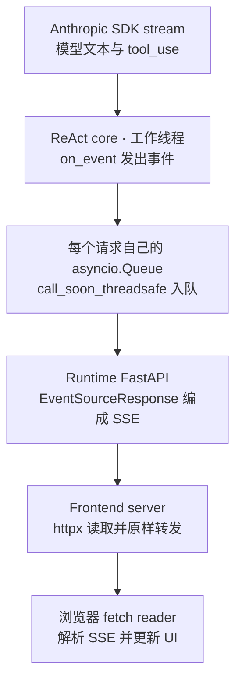
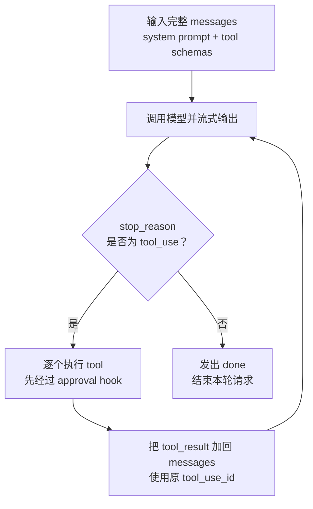
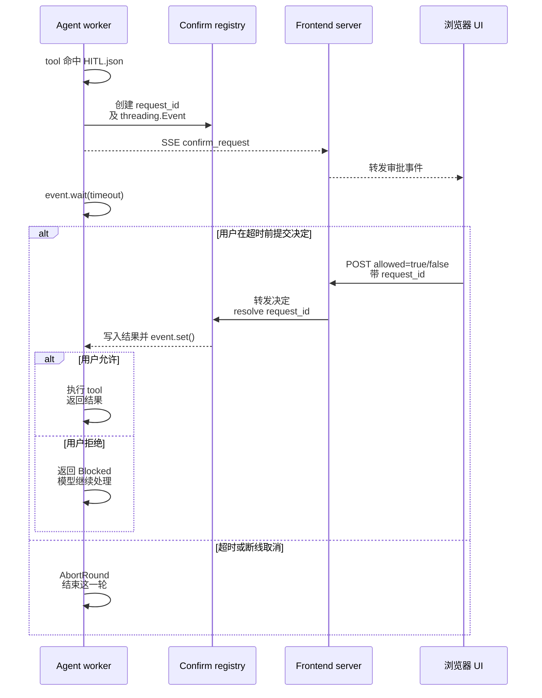
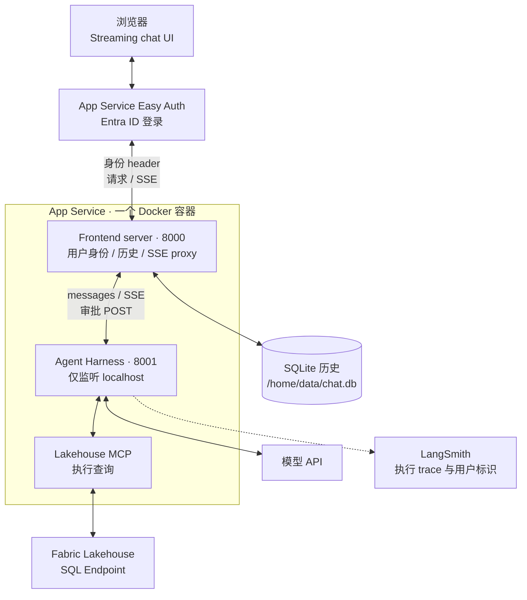

# 内部面试版：自研 ReAct Agent Harness 与 Streaming UI

**主线是：发现团队做 agent 时的重复需求，做出共用 harness 和 UI，再用 FUAM 展示具体实现。** 2026 年初，platform engineering 和 data engineering 团队都在探索 agent，你希望大家接入自己的 prompt、skills 和 tools，就能复用 streaming、chat history、tool approval、SSO 和 tracing。

本文以最新的 `fuam-agent/` 为技术依据。`agent_runtime_new/` 是通用多 agent demo，用来说明同一套 harness 如何接不同配置；两个版本的 ReAct loop、SSE 桥接和 HITL 机制相同。这里的 ReAct 指 tool-use loop；UI 实际用 HTML/CSS/vanilla JavaScript。

项目范围统一说明：你做了 Fabric Observability Agent 和 Ops Agent 两个内部 chatbot，最终没有正式上线。FUAM 源码能支持前一个用例的技术说明；Ops Agent 的业务范围依据你的说明和简历。以下部署内容来自代码和配置，本次没有验证 Azure 当前运行状态。

## 两分钟开场：建议直接练这一版

英文 237 词。按“为什么做 → 共用能力 → Azure 部署与登录 → 两个用例”讲，具体实现留给追问。

> In early 2026, platform engineering and data engineering teams were starting to explore agents. Things were moving fast, and I saw a common need: teams wanted to bring their own prompts, skills, and tools without rebuilding the runtime and chat UI each time.
>
> So I built a shared ReAct harness and a chat UI that saved conversations and streamed responses. Each agent used the same core loop: the model called tools, read the results, and continued until it had an answer. Teams supplied the domain knowledge, while the platform handled history, streaming, tool approvals, and tracing.
>
> I built the streaming path using SSE. The runtime emitted text, tool calls, and approval requests, and a frontend server forwarded those events to the browser. Tools configured to require approval waited for the user before running. I used LangSmith to trace model calls, tool calls, and approval waits.
>
> For the FUAM version on Azure, I packaged the frontend and runtime into one Docker image, pushed it to Azure Container Registry, and used a Linux App Service to run it. I configured the infrastructure with Bicep and used Easy Auth with Entra ID for sign-in. The frontend read the authenticated user's identity and used it to keep chat history separate by user.
>
> I built two internal chatbot use cases around this: a Fabric Observability Agent for usage and cost questions, and an Ops Agent for platform health questions and standup summaries.

### 中文怎么记

2026 年初，我们 platform engineering 和 data engineering 团队都开始探索 agent。我发现一个共同需求：大家想接入自己的 prompt、skills 和 tools，不想每次都重写 runtime 和聊天 UI。

所以我用 Python 做了一套共用的 ReAct harness，也写了 streaming UI。不同 agent 共用一个 loop：模型调用 tool，读取结果，再继续。团队负责业务知识，平台负责历史、streaming、审批和 tracing。

流式输出用 SSE：runtime 发出文字、tool call 和审批事件，frontend server 转发给浏览器。配置成需要审批的 tool，要等用户同意才执行。模型、tool 和审批等待都能在 LangSmith 里追踪。

FUAM 的 Azure 部署这块，我把 frontend 和 runtime 打进一个 Docker image，推到 ACR，用 Linux App Service 运行。基础设施用 Bicep 配置，登录交给 Easy Auth 和 Entra ID。frontend 读取登录用户的身份，按用户分开存取聊天历史。

后来我围绕这套东西做了两个内部 chatbot：Fabric Observability Agent 查使用量和成本，Ops Agent 查平台健康情况、生成 standup summary。

### 对方只给你 30 秒时

> In early 2026, our platform and data engineering teams were experimenting with agents, and I saw a lot of repeated work around the runtime and chat UI. I built a shared ReAct harness where teams could bring their prompts, skills, and tools, and reuse streaming, history, approvals, and tracing. I also built two chatbot use cases for Fabric observability and platform operations. These were internal prototypes.

## 技术追问一：Streaming 到底怎么实现，SSE 在哪里嫁接？

**这里有两层桥接：先把同步 agent 的事件接到异步 SSE，再把 runtime 的 SSE 接到浏览器。** frontend server 不重新解析模型输出，也不等完整回答生成后才返回。

### 整条链路



**第一层在 `agent_runtime/engine.py`。** 原来的 loop 和 tool 调用是同步代码，`chat_stream()` 把它交给 `ThreadPoolExecutor` 跑。worker 每产生一个事件就调用本次请求的 `on_event`。这个 callback 通过 `loop.call_soon_threadsafe(queue.put_nowait, evt)` 把事件安全地送回 FastAPI event loop。异步 generator 等待 `queue.get()`，有事件就 yield。

`api/routes/chat.py` 再用 `EventSourceResponse` 输出 SSE：`event` 是事件类型，`data` 是 JSON。这一层既解决同步／异步衔接，也把模型细节整理成 UI 能理解的协议。

**第二层在 `agent_frontend/server.py`。** 浏览器请求的是 frontend 的 `/api/sessions/{session_id}/chat`。server 读出这个 session 绑定的 `agent_url`，再用 `httpx.AsyncClient.stream()` 向 runtime 的 `/api/chat` 发 POST。它逐块读取 `aiter_raw()`，直接 yield 给 `StreamingResponse`。

这里转发的是字节流，**一个网络 chunk 不等于一个 SSE event**。server 不拆 SSE；它设置 `text/event-stream`、`Cache-Control: no-cache` 和 `X-Accel-Buffering: no`，避免这一层主动攒完整响应。中间如果另有 gateway，仍要检查实际的 buffering 配置。

**最后由浏览器解析。** `static/script.js` 用 POST `fetch()` 携带完整 messages，再从 `response.body.getReader()` 持续读。`TextDecoder` 以 streaming 模式处理跨 chunk 的 UTF-8；字符串 buffer 按空行拆完整 SSE frame，支持 LF 和 CRLF，剩余半帧留到下次。然后 `handleStreamEvent()` 按类型更新 UI。

这里用 fetch reader，因为聊天请求本身需要 POST JSON body；代码没有使用原生 `EventSource`。

### UI 收到的不只是文字

| 事件 | UI 做什么 |
| --- | --- |
| `text_delta` / `text_stop` | 追加文字、渲染 Markdown、关闭当前 text block |
| `tool_call` / `tool_result` | 显示 tool 卡片、更新结果，并建立对应的历史消息 |
| `confirm_request` | 显示 Allow / Deny 按钮 |
| `thinking_*` | 开启 thinking 时显示相应内容 |
| `token_usage` | 显示 token 和费用 |
| `done` | 标记本轮结束；正常完成路径由 loop 发一次 |
| `error` | 显示错误；异常退出不能保证也有正常的 `done` |

tool 参数的 JSON delta 先在 core 累积，模型这次响应完整后才进入 tool dispatch。

一轮里可能有多次模型调用，所以“一次模型响应结束”和“整个用户请求结束”要分开。当前 core 不在每次模型调用结束时发 `done`；普通 text block 用 `text_stop`，整轮结束才用 `done`。

### History 也沿着这条流重建

浏览器收到 `tool_call` 后建立 assistant 的 `tool_use` block，收到 `tool_result` 后建立与 tool ID 配对的 result。下一次模型输出到来时，UI 把前面的 assistant 和 tool result 分别提交到 messages，保留多次 tool 循环的顺序。

发起请求前会保存用户输入；stream 退出时，`finally` 会提交已收集的内容并尝试保存 session，因此异常时也可能保留部分回答。frontend server 在下一次转发前，用 `_strip_ui_fields()` 去掉 `meta` 和 tool 卡片的 `args_summary` 等 UI 字段，避免这些字段进入 Anthropic 请求导致 400。

### 面试里口头怎么说

> I kept the agent loop synchronous and ran it in a worker thread. Each request had its own callback and queue, which connected the loop to an async SSE response. Then the frontend server forwarded the SSE bytes to the browser without collecting the full response. The browser parsed the events and updated the text, tool cards, and approval controls as they arrived.

一句中文记法：**线程里产事件，queue 接回 async，runtime 编 SSE，frontend 原样转发，浏览器解析展示。**

## 技术追问二：自研 ReAct core 怎么实现？

**核心是一个 tool-use loop。模型决定下一步，harness 负责执行、审批、回传结果和记录 trace。** loop 直接调用 Anthropic SDK 的 tool-use API。



具体由 `core/loop.py` 的 `agent_loop()` 和 `_stream_response()` 完成：

1. 把 system prompt、tool schemas、完整 messages 发给模型，边读 stream 边发出 text/thinking 事件。
2. 取到模型的完整 assistant content，追加进 messages。
3. 如果 `stop_reason` 是 `tool_use`，按顺序处理 tool call；同一轮里的 tools 当前是串行执行。
4. `dispatch_tool()` 先走 hook，再调用内置 handler 或 MCP tool。结果按 `tool_use_id` 配对，加进 user-role 的 `tool_result` 消息。
5. 带着结果再次调用模型。没有继续请求 tool 时，发出 `done`，结束这次用户请求。

### FUAM 的 prompt、skills 和 tools 怎么配合

| 部分 | FUAM 里的职责 |
| --- | --- |
| System prompt | 放常用查询步骤、表的快速索引、T-SQL 规则和回答要求 |
| `capacity-metrics-query` | 说明 CU 查询该怎么 join，避免用当前 item 归属错误解释历史消耗 |
| `copilot-cu-attribution` | 说明 activity count 和 CU cost 的区别，以及 Copilot 成本归因方法 |
| `skills/schema/` | 保存完整 FUAM schema 参考文件，供查询表和字段；它不是一个带 SKILL.md 的独立 skill |
| Lakehouse MCP tools | 列表、查看字段、预览数据、执行 T-SQL |
| Harness | 负责 loop、tool dispatch、审批、streaming 和 tracing |

启动时，`SkillLoader` 扫描 `SKILL.md`，只把名称和 description 加入 system prompt。模型遇到相关问题，再通过 `load_skill` 读取正文；完整 schema 则按 prompt 中的路径查阅。

比如用户问某个 capacity 的 CU 消耗，专项 skill 要求直接使用 metrics 上记录的 `CapacityId`，而不是经由 item 当前所在的 workspace 推回 capacity。这样表达，比泛泛地说“我给 agent 加了领域知识”更具体。

system prompt 由团队的 `system.md` 加上 MCP tool 清单、workspace 规则和 skill descriptions 拼起来。同步 worker 调 MCP 时，`MCPManager` 通过自己的后台 asyncio loop 执行；这和 SSE 的 queue 桥接是两条不同的链路。

### 通用 harness 怎么复用到具体 agent

FUAM 的业务配置放在：

```text
agents/lakehouse-agent/
├── prompts/system.md
├── skills/
│   ├── capacity-metrics-query/SKILL.md
│   ├── copilot-cu-attribution/SKILL.md
│   └── schema/FUAM_Core_SM_Tables_Summary_EN.md
└── settings/
    ├── mcp.json
    └── HITL.json
```

FUAM 的根 Dockerfile 用 `AGENT_TARGET` 选择打包哪套配置。默认是 Lakehouse，目录中也有 FinOps 配置和 ADX/KQL MCP；它不等于简历里那个 Ops Agent。

通用 demo `agent_runtime_new/` 展示的是独立 frontend 加多个 agent runtime；FUAM 则把选定的 agent runtime 和 frontend 放进同一个 image。复用的是核心代码和配置格式，部署组合可以不同。FUAM 的创建 agent API 目前返回 501，新增 agent 仍需要准备配置并重新构建。

### 面试里口头怎么说

> The core was a loop around the model's native tool-use API. If the model requested tools, I ran them through the approval hook, executed them, and sent the results back with the matching tool IDs. Then the model continued. The shared loop stayed the same across agents; the system prompt, skills, and MCP configuration supplied the domain behavior.

## 技术追问三：Human-in-the-loop 怎么实现？

**审批在 tool dispatch 中执行，由后端拦住具体操作。** 这份实现处理的是 tool approval。



- `HITL.json` 是 tool 名称名单。例如 Lakehouse 模板配置了 `bash`、`write_file` 和 `edit_file`。是否需要批准取决于这份名单。
- 每次审批创建一个 `ConfirmSlot`，里面有独立的 `threading.Event`、`trace_id`、tool name 和结果；registry 用 `request_id` 查 slot，用 `trace_id` 找出本轮所有 pending slots。
- hook 发 `confirm_request` 给本次请求自己的 SSE。浏览器显示 tool 和参数预览，用户点击后，走独立的 confirm POST 回传 `allowed`。
- worker 在 `event.wait()` 等待，默认超时 600 秒。等待占用本次 worker thread，但不阻塞 FastAPI event loop，其他聊天仍可处理。
- 允许后才执行 tool；拒绝返回 `Blocked: User rejected`，模型还能继续；超时或取消则抛 `AbortRound`，补齐需要的 tool results 并结束本轮。
- engine 在收到 stream cancellation 时，按 trace 清理已挂起的审批。这个逻辑不等于能立即中断任意已经开始的 tool，也不等于已经完整处理所有时点的断线。

审批状态保存在当前进程的 registry，等待的是当前 worker thread。拒绝后模型可以继续；超时或取消则结束这一轮。它没有持久化 checkpoint，所以容器重启后需要重新发起请求。

### 面试里口头怎么说

> I put approval in the tool dispatch path. For configured tools, the backend created a pending request, sent an approval event to the UI, and waited on a per-request event. A separate POST carried the user's decision back. Allow executed the tool; deny went back to the model as a blocked result. The first version kept that state in memory, so it did not support durable pause and resume across restarts.

## 技术追问四：FUAM 在 Azure 上怎么部署？

**一个 App Service 运行一个包含 frontend 和 runtime 的 image。Easy Auth 放在入口，runtime 只接受容器内 localhost 请求。**



### 构建、发布和存储

| 环节 | 实际实现 |
| --- | --- |
| 创建资源 | `deployment/build.sh` 调用 Bicep，配置 App Service、ACR、Key Vault、Managed Identity 等资源，并设置 Easy Auth secret |
| 发布代码 | `deployment/deploy.sh` 构建 `linux/amd64` image，推到 ACR，更新 App Service image 配置并重启 |
| 启动进程 | `entrypoint.sh` 启动 frontend `0.0.0.0:8000` 和 runtime `127.0.0.1:8001`，各一个 worker |
| 保存历史 | Azure 配置使用 SQLite，路径 `/home/data/chat.db`，开启 App Service 持久化存储 |
| 读取配置 | runtime 启动时通过 Managed Identity 读取 Key Vault secrets，转成环境变量供 SDK 和 tools 使用 |
| 拉取镜像 | User-assigned Managed Identity 有 ACR 的 AcrPull 权限 |

历史由 frontend 管理；每次请求把完整 messages 发给 runtime。runtime 不存 conversation history，但本轮执行中的 queue 和审批仍在内存里。这个单 worker 版本可以处理多个并发聊天；扩到多 replica 时，还需要处理审批回到原进程的问题。

### Easy Auth 做什么，你的代码做什么？

Easy Auth 的 Bicep 配置开启 `requireAuthentication`。未登录先跳转 Entra ID；用户完成登录后，由 Easy Auth 管理登录 session，再把身份 header 交给应用。

你的 frontend 用 `X-MS-CLIENT-PRINCIPAL-ID` 取用户 object ID，解析 `X-MS-CLIENT-PRINCIPAL` 获取显示名。session CRUD 都用 object ID 作为存取条件。转发 chat 时，frontend 把 object ID 和用户名一并传给 runtime，runtime 再写进 LangSmith metadata。

> Easy Auth handled Entra ID sign-in at the App Service boundary. My frontend used the user's object ID to separate chat history, and passed the user identity into the runtime for tracing. The runtime itself was only reachable through localhost inside the container.

平台登录身份和 downstream credential 分开处理。Easy Auth 负责用户进入应用；Managed Identity 是服务自己的身份。这一版没有实现通过 OBO 让所有 tool 自动代表登录用户访问下游。

### Trace 怎么看？

`agent_round` 对应一次用户请求；模型调用用 `wrap_anthropic`，tool 和 approval wait 用 `@traceable`。`conversation_id` 把多轮请求归到同一 conversation，object ID 和用户名帮助定位是谁发起的请求。

Azure 模板也创建了 Application Insights 并设置 connection string；当前能从 agent 代码确认的执行 trace 接法是 LangSmith SDK，尚未找到 agent spans 通过 OTEL 上报的实现。

## 两个 chatbot 各做什么？

| Agent | 业务用途 | 本文依据 |
| --- | --- | --- |
| Fabric Observability Agent | Fabric refresh、使用量、成本、report ownership、Copilot usage 问答 | FUAM 的 Lakehouse 配置、MCP、prompt 和 skills，以及简历 |
| Ops Agent | Tableau、Power BI、关键 pipelines 的健康问答，以及 standup debrief | 你的说明和简历；当前 FUAM 目录不包含这套完整实现 |

> The Fabric chatbot focused on usage and cost questions. The Ops chatbot focused on platform health and standup summaries. Both used the shared harness approach.

项目结果讲“做出共用 harness、UI 和两个内部用例”即可。

## 如果被问：现在回看，会改什么？

| 改进点 | 当前实现与下一步 |
| --- | --- |
| TLS 校验 | 开启 LangSmith 时，config 会把新建 `requests.Session` 的 `verify` 默认设成 `False`。应恢复证书校验，有企业代理需求时配置可信 CA |
| 审批前校验 | 当前先经过 approval hook，再进入具体 tool 的参数／路径校验。应先做能提前完成的纯校验，减少无效审批 |
| 执行恢复与扩容 | 审批 slot 在进程内；要支持跨重启恢复或多 replica，需要设计任务状态、恢复方式和 confirm routing |
| 身份信任边界 | 当前依赖 Easy Auth 入口及 runtime 仅监听 localhost；若将 runtime 拆成独立服务，需要重新建立服务间认证与身份校验 |

这些是后续改进判断，当前没有修改实现。聊天历史按用户分开存取，也不代表 workspace 和所有 downstream 权限都已实现用户级隔离。

## 面试前只记住这几句

- 背景：2026 年初，团队都在探索 agent，共用需求开始重复出现。
- 你的贡献：自研 ReAct harness + streaming UI，把通用能力集中起来。
- 复用方式：同一 runtime，不同 prompt、skills、MCP 和 HITL 配置。
- Streaming：worker callback → queue → runtime SSE → frontend proxy → browser parser。
- HITL：tool 执行前由后端拦住，SSE 发审批，独立 POST 回传决定。
- Azure：一个 image 包含 frontend 和 runtime，ACR → App Service；Easy Auth 登录，object ID 区分用户历史。

## 源码复习入口

以下均指向 FUAM 最新版本。

| 想回忆什么 | 入口 |
| --- | --- |
| worker、queue、审批 registry、用户 trace metadata | [engine.py](/Users/wqeq/Desktop/external_project/dape_project_sync_0916/AgentDev/fuam-agent/agent_runtime/engine.py) |
| SSE 编码 | [chat route](/Users/wqeq/Desktop/external_project/dape_project_sync_0916/AgentDev/fuam-agent/agent_runtime/api/routes/chat.py) |
| Easy Auth、用户历史、SSE 与 confirm proxy | [frontend server](/Users/wqeq/Desktop/external_project/dape_project_sync_0916/AgentDev/fuam-agent/agent_frontend/server.py) |
| SSE parser、messages 重建、审批按钮 | [browser script](/Users/wqeq/Desktop/external_project/dape_project_sync_0916/AgentDev/fuam-agent/agent_frontend/static/script.js) |
| ReAct loop 与 prompt 拼装 | [loop.py](/Users/wqeq/Desktop/external_project/dape_project_sync_0916/AgentDev/fuam-agent/agent_runtime/core/loop.py) |
| 执行前 hook 与 tool dispatch | [tools.py](/Users/wqeq/Desktop/external_project/dape_project_sync_0916/AgentDev/fuam-agent/agent_runtime/core/tools.py) |
| skill 发现和按需加载 | [skills.py](/Users/wqeq/Desktop/external_project/dape_project_sync_0916/AgentDev/fuam-agent/agent_runtime/core/skills.py) |
| LangSmith wrapper 与 TLS 配置 | [config.py](/Users/wqeq/Desktop/external_project/dape_project_sync_0916/AgentDev/fuam-agent/agent_runtime/core/config.py) |
| 启动时加载 secrets | [keyvault.py](/Users/wqeq/Desktop/external_project/dape_project_sync_0916/AgentDev/fuam-agent/agent_runtime/keyvault.py) |
| FUAM 查询步骤 | [system prompt](/Users/wqeq/Desktop/external_project/dape_project_sync_0916/AgentDev/fuam-agent/agents/lakehouse-agent/prompts/system.md) |
| CU 查询 join 规则 | [capacity-metrics-query](/Users/wqeq/Desktop/external_project/dape_project_sync_0916/AgentDev/fuam-agent/agents/lakehouse-agent/skills/capacity-metrics-query/SKILL.md) |
| Copilot 成本归因 | [copilot-cu-attribution](/Users/wqeq/Desktop/external_project/dape_project_sync_0916/AgentDev/fuam-agent/agents/lakehouse-agent/skills/copilot-cu-attribution/SKILL.md) |
| FUAM schema | [schema reference](/Users/wqeq/Desktop/external_project/dape_project_sync_0916/AgentDev/fuam-agent/agents/lakehouse-agent/skills/schema/FUAM_Core_SM_Tables_Summary_EN.md) |
| 审批名单 | [HITL.json](/Users/wqeq/Desktop/external_project/dape_project_sync_0916/AgentDev/fuam-agent/agents/lakehouse-agent/settings/HITL.json) |
| 容器打包 | [Dockerfile](/Users/wqeq/Desktop/external_project/dape_project_sync_0916/AgentDev/fuam-agent/Dockerfile) |
| 容器内进程与端口 | [entrypoint.sh](/Users/wqeq/Desktop/external_project/dape_project_sync_0916/AgentDev/fuam-agent/entrypoint.sh) |
| Azure 资源和 Easy Auth | [infra.bicep](/Users/wqeq/Desktop/external_project/dape_project_sync_0916/AgentDev/fuam-agent/deployment/infra.bicep) |
| 创建基础设施 | [build.sh](/Users/wqeq/Desktop/external_project/dape_project_sync_0916/AgentDev/fuam-agent/deployment/build.sh) |
| 构建、推送和更新应用 | [deploy.sh](/Users/wqeq/Desktop/external_project/dape_project_sync_0916/AgentDev/fuam-agent/deployment/deploy.sh) |
